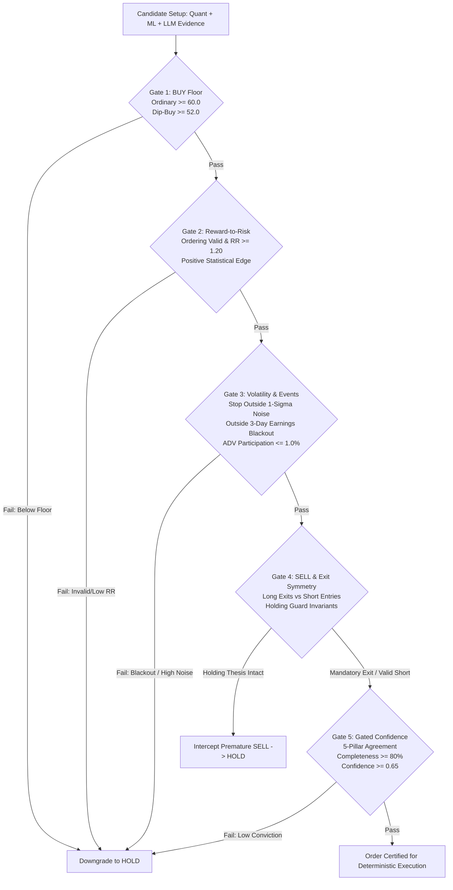

# Specification: Compliance Gate Semantics and Policy Engine (Step 5.3)

## 1. Overview & Architectural Hierarchy

Under the **Recommended Decoupled Architecture**, all directional setup certifications, risk vetos, and exit decisions are strictly governed by **deterministic compliance gates**. 

The Large Language Model (LLM) functions exclusively as an evidence extraction and risk-synthesis service. **Under no circumstances does an LLM output have execution authority, nor can it bypass price-ordering checks, override a failed quantitative score floor, or set an unvalidated risk amount.**

---

## 2. Gate 1: BUY Floor Semantics

### 2.1 Ordinary BUY Branch
- **Threshold**: Requires deterministic composite quantitative score $S \ge 60.0$ (`policy.scores.buy_minimum`).
- **Pillar Prerequisite**: At least 3 of the 5 quantitative pillars (Trend, Sector, Alpha, Valuation History, Peer Valuation) must be populated.
- **Inviolable Invariant**: An LLM advisory `BUY` cannot override a failed score requirement. For standard entries, if $S < 60.0$, the decision is unconditionally downgraded to `HOLD` with reason `COMPOSITE_BELOW_FLOOR`. There is **no subsequent universal rule** that converts every score below 60 to `HOLD`: qualified dip-buys execute on their own validated path.

### 2.2 Separately Eligible Dip-Buy Branch
The dip-buy branch represents a distinct investment thesis: buying a temporary adverse-catalyst dislocation in a fundamentally sound, cheap business rather than momentum trend-following.

| Condition | Required Boundary | Economic / Risk Rationale |
| :--- | :--- | :--- |
| **Catalyst Tag** | `catalyst_path == "DIP_BUY"` | Must be an identifiable dislocation event. |
| **Discount Score Floor** | $S \ge 52.0$ (`policy.scores.dip_buy_minimum`) | Accounts for momentum degradation caused by the dip. |
| **RSI (14-Day)** | $30.0 \le \text{RSI}_{14} \le 45.0$ | Must be genuinely oversold, but not in unrecoverable collapse. |
| **5-Day Drawdown** | $5.0\% \le \text{Drawdown}_{5d} \le 15.0\%$ | Healthy dislocation pullback, not structural insolvency. |
| **Valuation History** | $\text{Valuation Score} \ge 60.0$ | Business must be historically cheap (anti-value trap). |
| **Solvency Verification** | $\text{is\_value\_trap} == \text{False}$ | Solvency and cash flows must be verified intact. |

- **Precedence & Fallback**: If **any** of the structural dip-buy parameters fail, the floor immediately reverts to the standard $60.0$ threshold (`RULE_STANDARD_BUY_FLOOR`).

---

## 3. Gate 2: Reward-to-Risk Semantics

Evaluated via the deterministic engine in [`quant/trade_geometry.py`](file:///home/bhavin-thakkar/gitClient/ai_trader_gemini/quant/trade_geometry.py):

1. **Price Ordering Invariants**:
   - Long: $0 < \text{Stop} < \text{Entry} < \text{Target}$.
   - Short: $0 < \text{Target} < \text{Entry} < \text{Stop}$.
   - Non-positive prices or non-monotonic sequences trigger immediate rejection (`INVALID_PRICE_ORDERING`).
2. **Non-Negative Risk Denominator**:
   - Long risk denominator $(\text{Entry} - \text{Stop}) > 0$.
   - Short risk denominator $(\text{Stop} - \text{Entry}) > 0$.
   - Denominators $\le 0$ trigger immediate rejection (`ZERO_OR_NEGATIVE_RISK`).
3. **Threshold Clearance**:
   - Long: $RR_{\text{gross}} = \frac{\text{Target} - \text{Entry}}{\text{Entry} - \text{Stop}} \ge 1.20$.
   - Short: $RR_{\text{short}} = \frac{\text{Entry} - \text{Target}}{\text{Stop} - \text{Entry}} \ge 1.50$.
4. **Execution Friction & Statistical Edge Justification**:
   - Adjusts prices for 5 bps slippage, 1 bps commission, and short borrow fees.
   - Computes net break-even win rate: $\text{WinRate}_{\text{BE, net}} = \frac{1}{1 + RR_{\text{net}}} > \frac{1}{1 + RR_{\text{gross}}}$.
   - Empirical outcome evidence gate: Estimated win probability $p_{\text{win}}$ must exceed $\text{WinRate}_{\text{BE, net}}$ by at least the required edge ($\text{min\_edge\_pct} = 2.0\%$) and have strictly positive mathematical expectancy ($\mathbb{E}[R] > 0.0$). Otherwise rejected (`INSUFFICIENT_STATISTICAL_EDGE`).

---

## 4. Gate 3: Volatility, Events & Universal Liquidity Semantics

### 4.1 Options 1-Sigma Expected Move & Horizon
- **Source**: At-The-Money (ATM) Implied Volatility ($\sigma_{\text{IV}}$) extracted from options chain.
- **Horizon**: Trade horizon $T = 20$ trading days (`policy.volatility.option_horizon_days`).
- **Exact Formula**:
  $$\text{Expected Move}_{\pm 1\sigma} = S \times \left(\frac{\sigma_{\text{IV}}}{100}\right) \times \sqrt{\frac{T}{252}}$$
- **Missing / Illiquid Options Fallback**:
  When options data is unavailable, illiquid, or $\sigma_{\text{IV}} > 130\%$ (crisis regime), the engine falls back deterministically to realized ATR volatility:
  $$\text{Realized Expected Move}_{\pm 1\sigma} = \text{ATR}_{14} \times \sqrt{T}$$

### 4.2 Precision in Stop Placement: Noise Floor vs. Risk Cap
Moving a stop farther away reduces price-noise exits, but increases per-share dollar loss. The engine resolves this through three simultaneous controls:
1. **Noise Floor**: Stop distance must clear $\ge 0.85 \times \text{Expected Move}$ (or $1.5 \times \text{ATR}$). Stops inside this boundary fail Gate 3 (`STOP_INSIDE_NOISE_ZONE`).
2. **Per-Share Risk Cap**: Stop distance must NOT exceed $\text{max\_stop\_distance\_pct}$ ($30\%$).
3. **Risk-Parity Position Sizing**: When a wider stop is required to clear the noise floor, position size is dynamically scaled down:
   $$\text{Shares} = \frac{\text{Fixed Account Risk Budget}}{\text{Entry} - \text{Stop}}$$
   This guarantees that clearing the volatility noise floor **never expands total dollar capital risk**.

### 4.3 Scheduled Events & Earnings Blackout Boundaries
- **Earnings Blackout**: Mandatory prohibition of fresh entries when a scheduled earnings release is within $N = 3$ trading sessions (`EARNINGS_BLACKOUT`).
- **Scheduled Event Risk**: Mandatory prohibition of fresh entries into known binary corporate events (FDA approvals, major regulatory trials, investor days) (`EVENT_RISK`).
- **Ex-Dividend Blackout**: Mandatory prohibition of fresh short sales within 2 sessions of ex-dividend date (`EX_DIVIDEND_BLACKOUT`).

### 4.4 Universal Liquidity & Market Impact Sizing
The diagram's static checks ($\text{rvol}_{20d} \ge 0.50$ and $\text{ADTV}_{\$} \ge \$1\text{M}$) are supplemented by universal institutional controls:
1. **ADV Participation Limit**: Intended order size must not exceed $\alpha_{\text{participation}} = 1.0\%$ of 20-day Average Daily Dollar Volume ($\text{ADTV}_{\$}$):
   $$\text{Max Permitted Order Value} = \text{ADTV}_{\$} \times 0.01$$
2. **Square-Root Market Impact (Almgren-Chriss)**:
   $$\text{Estimated Impact (bps)} = 50.0 \times \left(\frac{\text{ATR}}{\text{Price}}\right) \times \sqrt{\frac{\text{Order Value}}{\text{ADTV}_{\$}}}$$
   If estimated impact exceeds $\text{max\_market\_impact\_bps}$ ($15.0\text{ bps}$), the setup is rejected (`LIQUIDITY_INSUFFICIENT`).

---

## 5. Gate 4: SELL and Exit Symmetry Semantics

### 5.1 Separation of Long Exits vs. Short Entries
- **Long Exit (`SELL` / `EXIT_LONG`)**: Liquidates an active holding. Does not require borrow availability or short breakdown scores.
- **Short Entry (`SELL` / `SHORT`)**: Initiates a fresh directional short. Requires:
  1. Structural breakdown score ($S \le 40.0$) or certified extension ($S \le 72.0$ with $\text{RSI} > 75$).
  2. Short reward-to-risk $RR_{\text{short}} \ge 1.50$.
  3. Clearance of earnings and ex-dividend blackouts.

### 5.2 Holding-Thesis Guard Forced Exit Invariants
The holding guard protects winning positions ($S \ge 70.0$) against premature noise exits. However, **it must NEVER block an exit under any of the following four mandatory conditions**:

| Priority | Forced Exit Condition | Code / Reason | Action |
| :---: | :--- | :--- | :--- |
| **1** | **Stop Loss Breach** ($\text{Price} \le \text{Stop}$) | `STOP_LOSS_BREACH` | Mandatory Execution (Guard Bypassed) |
| **2** | **Critical Evidence Veto** (DOJ probe, fraud, restatement) | `EVIDENCE_VETO_FORCED_EXIT` | Mandatory Execution (Guard Bypassed) |
| **3** | **Scheduled Earnings Blackout** ($\le 3$ sessions) | `EARNINGS_BLACKOUT_EXIT` | Mandatory Execution (Guard Bypassed) |
| **4** | **Catastrophic Collapse** ($S < 50.0$) | `THESIS_COLLAPSED` | Mandatory Execution (Guard Bypassed) |

---

## 6. Gate 5: Gated Confidence Semantics

### 6.1 Exact Mathematical Formula
Confidence represents the calibrated probability that the signal direction is accurate and supported by complete data:

1. **Directional Conviction Distance**:
   $$\text{Distance} = \min\left(1.0, \frac{|S - 50.0|}{50.0}\right)$$
2. **5-Pillar Consensus Dispersion**:
   $$\text{Mean Pillar} = \bar{P} = \frac{1}{K}\sum_{i=1}^K P_i$$
   $$\text{Dispersion} = \frac{\sum_{i=1}^K |P_i - \bar{P}|}{K \times 50.0}, \quad \text{Agreement} = 1.0 - \min(1.0, \text{Dispersion})$$
3. **Data Completeness Factor**:
   $$\text{Completeness} = \text{data\_completeness} \in [0.0, 1.0]$$
4. **Edge Strength & Base Confidence**:
   $$\text{Edge Strength} = 0.70 \times \text{Distance} + 0.30 \times (\text{Agreement} - 0.50)$$
   $$\text{Base Confidence} = 0.50 + 0.50 \times \text{Edge Strength}$$
5. **Final Scaled Confidence**:
   $$\text{Final Confidence} = \text{Base Confidence} \times (0.50 + 0.50 \times \text{Completeness})$$
   - If decision is `HOLD`: $\text{Final Confidence} = \min(\text{Final Confidence}, 0.60)$.

### 6.2 Missing-Data Policy
- If fewer than 3 pillars are available ($K < 3$), the composite score is invalid (`None`), completeness is severely penalized, and directional entry is rejected (`DATA_COVERAGE_INADEQUATE`).

### 6.3 Empirically Justified Threshold
- Directional BUY or SHORT entries require $\text{Confidence} \ge 0.65$ (`policy.trade_quality.min_confidence_threshold`).
- **Dip-Buy Pathway Precedence**: For certified dip-buys ($S \ge 52.0$), the verified dislocation catalyst boost ($+0.15$, ceiling $0.85$) is applied, and the candidate is evaluated against `policy.dip_buy.min_confidence_threshold` ($0.55$). No subsequent universal rule converts a score below 60 to `HOLD`.
- Setups with confidence failing their respective hurdle default to `HOLD`.

---

## 7. Verification & Test Suite Summary

Verified by [`tests/test_compliance_gates.py`](file:///home/bhavin-thakkar/gitClient/ai_trader_gemini/tests/test_compliance_gates.py):
- **Gate 1**: Standard 60.0 floor, 52.0 dip floor, dip disqualifications, LLM override prohibition.
- **Gate 2**: Geometry validity, risk denominators, threshold hurdles, statistical edge.
- **Gate 3**: $T=20$ IV expected move, ATR fallback, noise floor vs risk cap, ADV participation cap, market impact limit, earnings blackout.
- **Gate 4**: Holding guard interception, 4 mandatory forced exit invariants, short breakdown ceiling.
- **Gate 5**: Exact formula verification, missing-data policy ($< 3$ pillars), empirical 0.65 threshold.
- **End-to-End Orchestrator**: Unified hierarchical evaluation across all 5 gates.
