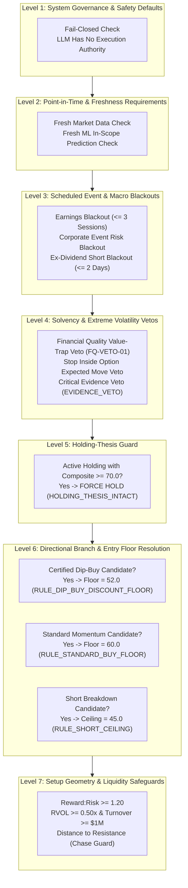

# Deterministic Policy Engine & Compliance Configuration Specification (Step 5.1)

**Document ID**: `SPEC-POLICY-ENGINE-V1`  
**Status**: APPROVED & IMPLEMENTED (Step 5.1)  
**Effective Date**: October 2026  
**Implementation Modules**:  
- [`config/trading_policy.yaml`](file:///home/bhavin-thakkar/gitClient/ai_trader_gemini/config/trading_policy.yaml)  
- [`quant/policy_config.py`](file:///home/bhavin-thakkar/gitClient/ai_trader_gemini/quant/policy_config.py)  
- [`policy_config.py`](file:///home/bhavin-thakkar/gitClient/ai_trader_gemini/policy_config.py)  
- [`main.py`](file:///home/bhavin-thakkar/gitClient/ai_trader_gemini/main.py)  
- [`tests/test_policy_config.py`](file:///home/bhavin-thakkar/gitClient/ai_trader_gemini/tests/test_policy_config.py)  

---

## 1. Executive Summary & Problem Formulation

Prior to Step 5.1, compliance safety thresholds and gating constants were scattered across multiple files (`main.py`, `catalyst_service.py`, `quantitative_scoring_service.py`), creating configuration drift, potential rule contradictions, and uncoordinated threshold adjustments.

### Key Conflict Resolutions in Step 5.1
1. **Contradictory BUY Score Floors Resolved**: A standard long entry requires $\text{Composite} \ge 60.0$, whereas a catalyst-driven dip-buy allows an entry at $\text{Composite} \ge 52.0$. The dip-buy branch is now formally decoupled into an independent rule set; it is not an arbitrary threshold softening, but a distinct state machine branch requiring verified adverse-news dislocation, oversold RSI $[30.0, 45.0]$, volume surge ($\text{RVOL} \ge 1.2\text{x}$), and robust fundamental valuation anchors (Valuation History $\ge 60.0$, Peer Valuation $\ge 55.0$).
2. **Conflicting Long Exit vs. Holding Guard Resolved**: To prevent minor noise, healthy pullbacks, or temporary momentum pauses from prematurely stopping out high-conviction winning investments, the **Holding-Thesis Guard** enforces that any active long holding with $\text{Composite} \ge 70.0$ and no fatal thesis breakdown is protected from liquidation (`HOLDING_THESIS_INTACT`).
3. **Overlapping Entry Zones Prevented**: We enforce a strict invariant: $\text{short\_maximum} < \text{buy\_minimum}$ ($45.0 < 60.0$), guaranteeing a definitive neutral buffer $[45.0, 60.0]$ where directional initiation is prohibited.

---

## 2. Deterministic Precedence Hierarchy

The deterministic policy engine enforces a strict 7-level evaluation precedence. Lower-level rules cannot override higher-level vetos:



---

## 3. Policy Configuration Schema ([`config/trading_policy.yaml`](file:///home/bhavin-thakkar/gitClient/ai_trader_gemini/config/trading_policy.yaml))

```yaml
version: "1.0.0"
policy_name: "Institutional Deterministic Compliance Policy"

scores:
  buy_minimum: 60.0
  dip_buy_minimum: 52.0
  short_maximum: 45.0
  holding_thesis_minimum: 70.0

dip_buy:
  enabled: true
  score_minimum: 52.0
  min_drop_pct_5d: 5.0
  max_drop_pct_5d: 15.0
  min_rsi: 30.0
  max_rsi: 45.0
  min_valuation_history: 60.0
  min_peer_valuation: 55.0
  min_rvol: 1.2
  max_catalyst_age_days: 3
  forbid_value_trap: true
  forbid_collapse: true

trade_quality:
  reward_risk_minimum: 1.20
  min_data_completeness: 0.80
  min_rvol_20d: 0.50
  min_avg_dollar_volume: 1000000.0
  max_distance_to_resistance_atr: 0.80
  min_wall_street_rr: 1.0

events:
  earnings_blackout_sessions: 3
  event_risk_blackout: true
  ex_dividend_short_blackout_days: 2

volatility:
  min_vol_factor: 0.80
  max_stop_expected_move_ratio: 0.85
  reject_extreme_regime: true

data_quality:
  require_fresh_market_data: true
  require_fresh_ml_data_for_in_scope_tickers: true
  max_market_data_staleness_days: 5
  max_ml_score_staleness_days: 5

holding_guard:
  enabled: true
  thesis_intact_score_minimum: 70.0
  prevent_premature_exit: true

policy:
  llm_has_execution_authority: false
  fail_closed_for_new_entries: true
  enable_evidence_veto: true
  enable_value_trap_veto: true
```

---

## 4. Typed Configuration Architecture ([`quant/policy_config.py`](file:///home/bhavin-thakkar/gitClient/ai_trader_gemini/quant/policy_config.py))

### Key Methods
- `resolve_buy_score_floor(is_certified_dip_buy: bool) -> Tuple[float, str]`:
  Selects branch-specific floor ($52.0$ for dip-buys vs. $60.0$ for standard momentum).
- `is_holding_thesis_intact(is_holding: bool, composite_score: float, has_critical_risk: bool) -> bool`:
  Evaluates holding protection; permits liquidation if thesis is broken or critical evidence veto occurs.
- `validate() -> None`:
  Enforces sanity bounds, checks against contradictory thresholds, and rejects overlapping signal zones.

---

## 5. Verification & Test Suite Status

Verified across 8 dedicated unit tests in [`tests/test_policy_config.py`](file:///home/bhavin-thakkar/gitClient/ai_trader_gemini/tests/test_policy_config.py):
1. `test_policy_yaml_loading_completeness`: **PASS**
2. `test_rejection_of_contradictory_dip_buy_floor`: **PASS**
3. `test_rejection_of_overlapping_long_short_thresholds`: **PASS**
4. `test_rejection_of_invalid_bounds`: **PASS**
5. `test_resolve_buy_score_floor_precedence`: **PASS**
6. `test_holding_thesis_guard_prevents_premature_exit`: **PASS**
7. `test_normalize_enforces_policy_thresholds`: **PASS**
8. `test_environment_variable_overrides`: **PASS**
