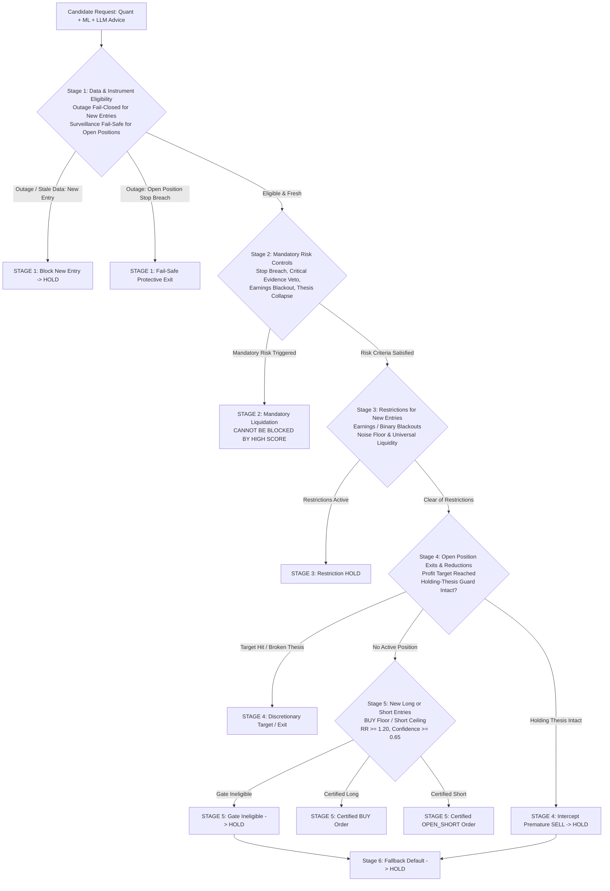

# Specification: Deterministic Decision Precedence Engine (Step 5.4)

## 1. Overview & Architectural Hierarchy

The **Deterministic Decision Precedence Engine** establishes a strict, immutable 6-stage decision hierarchy that executes prior to any order generation or state mutation. 

Under this decoupled architecture, the Large Language Model (LLM) and Machine Learning (ML) rankers provide advisory inputs, feature extraction, and candidate hypotheses. **Deterministic policy rules govern precedence and execution authority.**



---

## 2. Five Distinct Internal Action Types

To prevent ambiguity between liquidating an existing long and initiating a directional short, the engine defines **five distinct internal action types**:

```python
class InternalActionType(str, Enum):
    BUY = "BUY"                    # Opening or adding to a long position
    HOLD = "HOLD"                  # Maintaining existing state or no-trade fallback
    SELL_TO_CLOSE = "SELL_TO_CLOSE"# Closing / liquidating an existing long position
    OPEN_SHORT = "OPEN_SHORT"      # Opening a fresh directional short position
    COVER_SHORT = "COVER_SHORT"    # Buying to close / covering an existing short position
```

### Bidirectional External UI Mapping
For backward compatibility with external displays and dashboard interfaces:

| Internal Action Type | External UI `decision` | External UI `sell_type` | Economic Meaning |
| :--- | :--- | :--- | :--- |
| `BUY` | `BUY` | `None` | Fresh long entry / expansion |
| `HOLD` | `HOLD` | `None` | Neutral / wait / thesis maintained |
| `SELL_TO_CLOSE` | `SELL` | `"LONG_EXIT"` | Liquidating open long holding |
| `OPEN_SHORT` | `SELL` | `"SHORT"` | Establishing fresh short exposure |
| `COVER_SHORT` | `BUY` | `"COVER_SHORT"` | Buying to close short exposure |

---

## 3. Strict 6-Stage Execution Sequence

The engine enforces precedence in strict sequential order. Execution stops and returns the deterministic decision at the earliest decisive stage.

### Stage 1: Validate Data and Instrument Eligibility
- **Principle**: Fail-closed on missing, stale, or outage data for new entries. **Never silently substitute neutral-looking scores (e.g. 50.0) during an outage.**
- **New Entries**: If market data is stale, ML features are stale, price is missing or non-positive, or ATR is invalid ($\le 0$), all fresh entries are strictly blocked:
  $$\text{Action} = \text{HOLD}, \quad \text{Reason} = \text{"DATA\_OUTAGE\_NEW\_ENTRIES\_BLOCKED"}$$
- **Open-Position Fail-Safe Surveillance**: Data outages do **not** excuse ignoring open-position risk. The engine runs fail-safe surveillance on existing holdings:
  1. *Stop-Loss Breach*: If last known quote $\le$ stop price (or $\ge$ stop price for short), immediate liquidation triggers:
     $$\text{Action} = \text{SELL\_TO\_CLOSE} \quad (\text{or } \text{COVER\_SHORT})$$
  2. *Critical Evidence Veto*: Qualitative disaster flags (regulatory sanctions, material fraud) force liquidation regardless of feed health.
  3. *Outage Timeout*: If outage duration exceeds maximum tolerance ($\ge 2.0\text{ hours}$ by default), protective de-risking triggers:
     $$\text{Action} = \text{SELL\_TO\_CLOSE}, \quad \text{Reason} = \text{"DATA\_OUTAGE\_PROTECTIVE\_LIQUIDATION"}$$

---

### Stage 2: Apply Mandatory Existing-Position Risk Controls
- **Invariant**: **Mandatory risk controls CANNOT be blocked or overridden by a high quantitative score (e.g. $S = 85.0$).**
- **Trigger Conditions**:
  1. *Stop-Loss Breach*: Current price breaches stop boundary ($P \le \text{Stop}_{\text{long}}$ or $P \ge \text{Stop}_{\text{short}}$).
  2. *Critical Qualitative Risk Veto*: Regulatory investigations, material accounting restatements, or solvency veto flags.
  3. *Earnings Blackout Boundary*: Position holding inside binary blackout window ($\le 3$ trading sessions to earnings release) where policy mandates liquidation.
  4. *Catastrophic Composite Collapse*: Score collapse ($S < 50.0$ for long holdings, or $S > 60.0$ for short holdings).
- **Result**: Immediate liquidation (`SELL_TO_CLOSE` or `COVER_SHORT`).

---

### Stage 3: Apply Event, Liquidity, and Compliance Restrictions
Evaluated for fresh entry candidates prior to setup geometry:
1. *Earnings Blackout*: Fresh entries prohibited within `earnings_blackout_sessions` (default 3 sessions).
2. *Options 1-Sigma Expected Move Noise Floor*:
   $$\text{Stop Distance} \ge 0.85 \times \text{Expected Move}_{1\sigma}$$
   Stops placed inside expected market volatility noise trigger `STOP_INSIDE_NOISE_ZONE`.
3. *Universal Liquidity Controls*:
   - Relative Volume $\text{RVOL}_{20d} \ge 0.50\times$.
   - 20-day Average Daily Dollar Volume $\text{ADV}_{20d} \ge \$1,000,000$.
   - Intended Order Value $\le 1.0\%$ of $\text{ADV}_{20d}$.
   - Square-Root Market Impact $\le 15.0\text{ bps}$.
- **Result**: Ineligibility blocks entry and returns `InternalActionType.HOLD`.

---

### Stage 4: Evaluate Existing-Position Exits and Reductions
Evaluated for active holdings:
1. *Profit Target Achieved*: Current price reaches target ($P \ge \text{Target}_{\text{long}}$ or $P \le \text{Target}_{\text{short}}$) $\implies$ `SELL_TO_CLOSE` or `COVER_SHORT`.
2. *Holding-Thesis Guard*: If the thesis remains intact ($S \ge 70.0$, stop not breached, target not reached), premature discretionary or LLM `SELL` calls are intercepted and downgraded to `HOLD`.
3. *Discretionary Exit*: If thesis is degraded ($S < 70.0$), discretionary exit is permitted $\implies$ `SELL_TO_CLOSE`.

---

### Stage 5: Evaluate New Long or Short Entries
Evaluated for flat positions seeking entry:
- **Long Entry Branch (`BUY`)**:
  1. Gate 1: Composite $\ge 60.0$ (or certified dip-buy $\ge 52.0$).
  2. Gate 2: Reward-to-Risk $RR_{\text{net}} \ge 1.20$ with verified positive edge.
  3. Gate 5: Gated Confidence $\ge 0.65$ with $\ge 3$ agreeing pillars.
  - *All Passed* $\implies$ `InternalActionType.BUY` (`BUY_ORDER_CERTIFIED`).
- **Short Entry Branch (`SELL` / `SHORT`)**:
  1. Gate 4: Composite $\le 45.0$ (or certified extension $\le 60.0$).
  2. Gate 2: Reward-to-Risk $RR_{\text{net}} \ge 1.50$ (higher short bar).
  3. Gate 5: Gated Confidence $\ge 0.65$.
  - *All Passed* $\implies$ `InternalActionType.OPEN_SHORT` (`SHORT_ORDER_CERTIFIED`).
- *Failure on any gate* $\implies$ `InternalActionType.HOLD`.

---

### Stage 6: Return HOLD / NO_TRADE Fallback
- Any candidate setup that does not yield a certified entry or exit falls through to `InternalActionType.HOLD` with reason code `NO_TRADE_DEFAULT`.

---

## 4. Audit Log Schema

Every evaluation produces a structured `PrecedenceEvaluationResult`:
```python
@dataclass
class PrecedenceEvaluationResult:
    internal_action: InternalActionType
    external_decision: str
    external_sell_type: Optional[str]
    resolved_stage: DecisionStage
    reason_code: str
    message: str
    metrics: Dict[str, Any]
    stage_audit_log: List[Dict[str, Any]]
```

---

## 5. Verification & Compliance Matrix

| Stage | Feature / Rule | Verified In | Status |
| :--- | :--- | :--- | :--- |
| **Stage 1** | Fail-closed on outage for new entries (no neutral 50.0 substitution) | `test_stage1_data_outage_blocks_new_entry` | ✅ PASS |
| **Stage 1** | Open position stop breach fail-safe surveillance during outage | `test_stage1_open_position_failsafe_stop_breach_during_outage` | ✅ PASS |
| **Stage 1** | Critical evidence veto fail-safe during outage | `test_stage1_open_position_failsafe_evidence_veto_during_outage` | ✅ PASS |
| **Stage 1** | Outage duration timeout protective liquidation ($\ge 2.0$h) | `test_stage1_open_position_failsafe_outage_timeout` | ✅ PASS |
| **Stage 2** | High score ($S=85$) CANNOT block stop-loss breach | `test_stage2_high_score_cannot_block_stop_breach` | ✅ PASS |
| **Stage 2** | Critical evidence veto forces liquidation | `test_stage2_high_score_cannot_block_critical_evidence_veto` | ✅ PASS |
| **Stage 2** | Binary earnings blackout forces liquidation | `test_stage2_earnings_blackout_forced_liquidation` | ✅ PASS |
| **Stage 2** | Catastrophic thesis collapse liquidation ($S < 50$) | `test_stage2_catastrophic_thesis_collapse` | ✅ PASS |
| **Stage 3** | Restrictions block fresh entries (blackout, noise, liquidity) | `test_stage3_*` | ✅ PASS |
| **Stage 4** | Profit target reached triggers `SELL_TO_CLOSE` / `COVER_SHORT` | `test_stage4_target_price_achieved` | ✅ PASS |
| **Stage 4** | Holding-thesis guard intercepts premature discretionary exit | `test_stage4_holding_thesis_guard_prevents_premature_exit` | ✅ PASS |
| **Stage 5** | Fully certified long produces `InternalActionType.BUY` | `test_stage5_certified_long_produces_buy` | ✅ PASS |
| **Stage 5** | Fully certified short produces `InternalActionType.OPEN_SHORT` | `test_stage5_certified_short_produces_open_short` | ✅ PASS |
| **Stage 6** | Fallback default produces `InternalActionType.HOLD` | `test_stage6_no_trade_fallback` | ✅ PASS |
| **Mapping**| 5 internal action types map bidirectionally to external UI | `test_internal_action_types_and_ui_mapping` | ✅ PASS |
