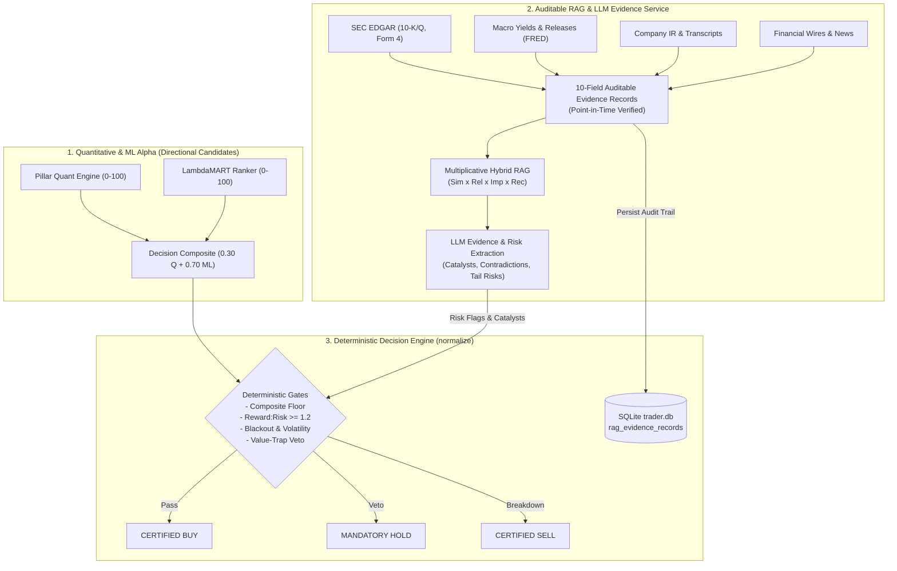

# Evidence-Based RAG & Auditable Evidence Record Specification

**Document ID**: `SPEC-RAG-EVIDENCE-V1`  
**Status**: APPROVED & IMPLEMENTED (Step 4.1)  
**Effective Date**: October 2026  
**Implementation Modules**:  
- [`evidence_record.py`](file:///home/bhavin-thakkar/gitClient/ai_trader_gemini/evidence_record.py)  
- [`db.py`](file:///home/bhavin-thakkar/gitClient/ai_trader_gemini/db.py)  
- [`rag_service.py`](file:///home/bhavin-thakkar/gitClient/ai_trader_gemini/rag_service.py)  
- [`main.py`](file:///home/bhavin-thakkar/gitClient/ai_trader_gemini/main.py)  
- [`tests/test_evidence_record.py`](file:///home/bhavin-thakkar/gitClient/ai_trader_gemini/tests/test_evidence_record.py)  

---

## 1. Executive Summary & Architectural Realignment

In Step 4, we resolve the architectural conflict between non-deterministic Large Language Model (LLM) advisory synthesis and institutional trade execution safety. 

### The Problem: LLMs as Necessary Approval Conditions
Previous architecture iterations designated the master LLM as "advisory," yet required an LLM-proposed `BUY` as a mandatory precondition along the certified execution path. This gave the LLM de facto veto and initiation authority, introducing:
1. **Unpredictable Directional Censorship**: High-alpha quantitative setups ($Q \ge 70$, strong momentum, high Sharpe) could be rejected arbitrarily due to prompt variability, temperature fluctuations, or hallucinated risks.
2. **Unverifiable Rationale**: LLM recommendations relying on unanchored web chatter or secondary news headlines lack provenance and auditability.
3. **Temporal Leakage**: Standard vector retrieval without point-in-time constraints can inadvertently ingest material published *after* the simulated decision timestamp, invalidating backtests.

### The Solution: Decoupled Evidence & Risk-Analysis Architecture
We adopt the **LLM as an Evidence and Risk-Analysis Service** architecture:
- **Directional Candidate Generation**: The candidate trade setup and baseline direction originate strictly from the Quantitative Composite engine (Track A) and Point-in-Time LambdaMART Ranker (Track B).
- **Qualitative Evidence Extraction**: The LLM functions exclusively as an evidence extraction and risk analysis engine. It digests primary source passages to identify upcoming catalysts, macro regime shifts, and cross-pillar contradictions.
- **Deterministic Risk Gates**: Only explicit, mathematically validated rules in the deterministic decision engine can alter order eligibility, adjust confidence, or enforce a capital-protection veto.
- **Auditable Provenance**: Every qualitative assertion in the LLM analysis must trace directly to an immutable, point-in-time auditable evidence record stored in the relational database.



---

## 2. Explicit 10-Field Auditable Evidence Record Schema

For every source passage that informs an analysis, the system captures and persists a canonical 10-field schema:

| Field Name | Type | Description | Verification / Invariant |
| :--- | :--- | :--- | :--- |
| `document_id` | `VARCHAR(64)` | Deterministic unique SHA256 identifier | Format: `doc_{ticker}_{source_type}_{date}_{sha256[:12]}` |
| `ticker` | `VARCHAR(16)` | Target instrument ticker symbol | Uppercase standardized ticker (e.g., `MSFT`, `NVDA`) |
| `source_type` | `VARCHAR(32)` | Standardized source origin enum | Must match `SourceType` enum values |
| `source_url` | `TEXT` | Canonical URL or primary document link | EDGAR accession URL, FRED series URL, or news link |
| `publication_timestamp`| `VARCHAR(32)` | Time document was created / authored | ISO 8601 UTC timestamp (`YYYY-MM-DDTHH:MM:SSZ`) |
| `available_timestamp` | `VARCHAR(32)` | Time document became publicly accessible | Dissemination / embargo expiration timestamp |
| `retrieval_timestamp` | `VARCHAR(32)` | Time passage was fetched into RAG context | Ingestion timestamp during analysis pipeline |
| `passage_or_excerpt` | `TEXT` | Verbatim text excerpt retrieved | Raw text snippet evaluated by embedding & LLM |
| `event_type` | `VARCHAR(32)` | Categorized corporate or macro event | Must match `EventType` enum values |
| `event_horizon` | `VARCHAR(32)` | Expected duration / impact horizon | Must match `EventHorizon` enum values |

### Data Enums Definition

```python
class SourceType(str, Enum):
    # Primary Sources (Highest Authority)
    SEC_FILING = "SEC_FILING"                       # 10-K, 10-Q, 8-K, Form 4
    MACRO_RELEASE = "MACRO_RELEASE"                 # FRED, BLS, Fed policy statement
    COMPANY_IR = "COMPANY_IR"                       # Official press release, IR portal
    EARNINGS_CALL_TRANSCRIPT = "EARNINGS_CALL_TRANSCRIPT"
    # Secondary Sources
    ANALYST_RESEARCH = "ANALYST_RESEARCH"           # Brokerage equity research
    REPUTABLE_NEWS = "REPUTABLE_NEWS"               # Reuters, Bloomberg, WSJ
    GENERAL_NEWS = "GENERAL_NEWS"                   # MarketWatch, Yahoo, CNBC
    SOCIAL_MEDIA = "SOCIAL_MEDIA"                   # Reddit, Twitter/X, forums
    INTERNAL_MODEL = "INTERNAL_MODEL"               # Quant/ML model output summary

class EventType(str, Enum):
    EARNINGS = "EARNINGS"
    GUIDANCE = "GUIDANCE"
    PRODUCT_LAUNCH = "PRODUCT_LAUNCH"
    REGULATION = "REGULATION"
    M_AND_A = "M_AND_A"
    MANAGEMENT_CHANGE = "MANAGEMENT_CHANGE"
    ANALYST_REVISION = "ANALYST_REVISION"
    INSIDER_TRANSACTION = "INSIDER_TRANSACTION"
    DIVIDEND_SPLIT = "DIVIDEND_SPLIT"
    MACRO_INTEREST_RATE = "MACRO_INTEREST_RATE"
    MACRO_INFLATION = "MACRO_INFLATION"
    MACRO_EMPLOYMENT = "MACRO_EMPLOYMENT"
    GEOPOLITICAL = "GEOPOLITICAL"
    GENERAL_MARKET = "GENERAL_MARKET"

class EventHorizon(str, Enum):
    IMMEDIATE_24H = "IMMEDIATE_24H"                 # Breaking catalyst / overnight news
    SHORT_TERM_7D = "SHORT_TERM_7D"                 # 1-week momentum catalyst
    SWING_20D = "SWING_20D"                         # 20-session trading swing target
    INTERMEDIATE_90D = "INTERMEDIATE_90D"           # Quarterly earnings cycle
    STRUCTURAL_MULTI_YEAR = "STRUCTURAL_MULTI_YEAR" # Multi-year competitive moat / balance sheet
```

---

## 3. Primary vs. Secondary Source Priority

To prevent noisy financial blogs or unverified social chatter from distorting trade risk assessments, the RAG retrieval engine enforces an explicit Source Reliability Hierarchy:

$$\text{Reliability Weight} \in [0.30, 1.00]$$

| Source Category | Reliability Weight | Authority Classification | Example Channels |
| :--- | :---: | :--- | :--- |
| **SEC Filings** | **1.00** | Maximum Primary Authority | EDGAR 10-K, 10-Q, 8-K, Form 4 insider transactions |
| **Official Macro Releases** | **1.00** | Maximum Primary Authority | FRED (DGS10, DFII10, FEDFUNDS), BLS CPI/Jobs |
| **Company IR** | **0.95** | Very High Primary Authority | Official corporate press releases, investor presentations |
| **Earnings Transcripts** | **0.90** | High Primary Authority | Verbatim CEO/CFO conference call statements |
| **Tier-1 Financial Wires** | **0.90** | High Secondary Authority | Reuters, Bloomberg News, Wall Street Journal |
| **Analyst Research** | **0.75** | Moderate Secondary Authority | Wall Street bank equity research & target revisions |
| **General Financial Media**| **0.70** | Secondary Authority | MarketWatch, CNBC, Yahoo Finance, SeekingAlpha |
| **Social Media / Retail** | **0.30** | Low-Conviction Chatter | StockTwits, Reddit, Twitter/X chatter |

### Multiplicative Hybrid Scoring Integration
In `rag_service.py`, document passages are split into 450-character chunks with 50-character overlap and embedded via FastEmbed (`BAAI/bge-small-en-v1.5`, 384-dimensional dense vectors). The final relevance score for ranking retrieved chunks against analytical sub-queries is computed multiplicatively:

$$\text{HybridScore} = \text{CosineSimilarity} \times \text{Reliability} \times \text{Importance} \times \text{Recency} \times \text{HorizonPenalty}$$

Where:
- $\text{CosineSimilarity} = \frac{\mathbf{e}_{\text{chunk}} \cdot \mathbf{e}_{\text{query}}}{\|\mathbf{e}_{\text{chunk}}\| \|\mathbf{e}_{\text{query}}\|}$
- $\text{Reliability} \in [0.30, 1.00]$ from the source priority hierarchy.
- $\text{Importance} \in [0.50, 1.00]$ assigned based on document type (filings/earnings = 1.0, general news = 0.8).
- $\text{Recency} \in [0.30, 1.00]$ exponentially decaying based on passage age relative to decision date.
- $\text{HorizonPenalty} = 1.00$ if passage matches query horizon preference (`CURRENT` vs `HISTORICAL`), else $0.50$.

**Impact**: Because primary sources carry $1.00$ reliability vs $0.70$ for financial media and $0.30$ for forums, an SEC 10-K passage will strictly outrank a media blog post even if the blog post has slightly higher lexical keyword overlap.

---

## 4. Point-in-Time Zero-Lookahead Guarantees

In backtesting and historical simulation, information leakage from the future renders results invalid. The RAG retrieval pipeline enforces strict point-in-time constraints.

### Admissibility Criteria
A document $D$ is admissible as of simulated decision time $T_{\text{as\_of}}$ if and only if:

$$\text{publication\_timestamp}(D) \le T_{\text{as\_of}} \quad \land \quad \text{available\_timestamp}(D) \le T_{\text{as\_of}}$$

```python
def is_point_in_time(
    publication_timestamp: str,
    available_timestamp: str,
    as_of_timestamp: str
) -> bool:
    """
    Validates whether a document was publicly available at or before simulated decision time.
    Rejects any future documents or embargoed releases.
    """
    if not as_of_timestamp:
        return True  # Real-time mode: current wall-clock time
    as_of = parse_iso_timestamp(as_of_timestamp)
    pub = parse_iso_timestamp(publication_timestamp)
    avail = parse_iso_timestamp(available_timestamp)
    return pub <= as_of and avail <= as_of
```

### Embargo and After-Market Protection
1. **Embargo Handling**: If a company issues earnings at 16:05 UTC (`publication_timestamp`), but public market wire distribution is embargoed until 16:30 UTC (`available_timestamp`), an as-of query at 16:15 UTC will reject the passage because `avail > as_of`.
2. **Database Point-in-Time Querying**: `db.query_evidence_as_of()` filters directly at the SQLite SQL level:
   ```sql
   SELECT * FROM rag_evidence_records
   WHERE ticker = ? 
     AND publication_timestamp <= ? 
     AND available_timestamp <= ?
   ORDER BY publication_timestamp DESC
   LIMIT ?;
   ```

---

## 5. Database Persistence Architecture

Auditable evidence records are persisted to SQLite (`trader.db`) with relational integrity linked to trading signals:

```sql
CREATE TABLE IF NOT EXISTS rag_evidence_records (
    id INTEGER PRIMARY KEY AUTOINCREMENT,
    signal_id INTEGER,
    document_id TEXT NOT NULL,
    ticker TEXT NOT NULL,
    source_type TEXT NOT NULL,
    source_url TEXT,
    publication_timestamp TEXT NOT NULL,
    available_timestamp TEXT NOT NULL,
    retrieval_timestamp TEXT NOT NULL,
    passage_or_excerpt TEXT NOT NULL,
    event_type TEXT NOT NULL,
    event_horizon TEXT NOT NULL,
    FOREIGN KEY(signal_id) REFERENCES signals(id)
);

CREATE INDEX IF NOT EXISTS idx_evidence_ticker ON rag_evidence_records(ticker);
CREATE INDEX IF NOT EXISTS idx_evidence_doc_id ON rag_evidence_records(document_id);
CREATE INDEX IF NOT EXISTS idx_evidence_pub_avail ON rag_evidence_records(publication_timestamp, available_timestamp);
```

### Automatic Pipeline Linkage
When `main.py` executes:
1. `rag_service.get_nemotron_payload()` collects all retrieved passages into `self.last_retrieved_evidence_records` and embeds them into `payload["evidence_records"]`.
2. `main.py` attaches `context.get("evidence_records", [])` to `normalized_obj`.
3. `db.save_results()` persists the signal in `signals` table, acquires `signal_id = cursor.lastrowid`, and calls `_save_evidence_records_with_cursor(records, signal_id, cursor)` within the same database transaction.
4. If the database commit succeeds, both the signal and its supporting auditable evidence records are atomically committed.

---

## 6. Verification and Test Coverage

The Step 4.1 evidence record implementation is verified across 9 dedicated unit tests in [`tests/test_evidence_record.py`](file:///home/bhavin-thakkar/gitClient/ai_trader_gemini/tests/test_evidence_record.py):

| Test Case | Description | Result |
| :--- | :--- | :---: |
| `test_evidence_record_schema_fields` | Verifies all 10 required schema fields are present and non-empty | **PASS** |
| `test_source_reliability_hierarchy` | Verifies primary sources carry weights 0.90–1.00 vs secondary 0.70–0.75 | **PASS** |
| `test_deterministic_document_id_generation`| Verifies document ID generation is stable and deterministic | **PASS** |
| `test_point_in_time_filtering` | Verifies documents after as-of timestamp or embargoed are rejected | **PASS** |
| `test_database_persistence_and_retrieval` | Verifies SQLite CRUD operations for evidence records | **PASS** |
| `test_foreign_key_linkage_with_signal` | Verifies `save_results()` automatically links evidence to signal ID | **PASS** |
| `test_point_in_time_database_query` | Verifies `query_evidence_as_of()` strictly filters future records | **PASS** |
| `test_rag_service_evidence_payload_embedding` | Verifies `get_nemotron_payload()` attaches evidence records | **PASS** |
| `test_historical_point_in_time_rag_retrieval` | Verifies `retrieve_evidence_as_of()` functions as advertised | **PASS** |

**Repository Test Status**:
- `tests/test_evidence_record.py`: 9/9 PASS.
- Full Unit Test Discovery (`unittest discover`): **255/255 PASS**.
- Walk-Forward & Quant Test Suite (`stock-ml pytest`): **48/48 PASS**.
- Zero regressions across existing API and scoring endpoints.

---

## 7. Step 4.2 — Strict LLM Evidence Analysis Schema & Validator

### Architecture & Motivation
In Step 4.2, we replace free-form LLM decision authority with a strict, typed Pydantic schema ([`llm_evidence_schema.py`](file:///home/bhavin-thakkar/gitClient/ai_trader_gemini/llm_evidence_schema.py)):
1. **No Unrestricted Execution**: The LLM output must never contain broker commands or order parameters. It cannot initiate or authorize trades.
2. **Limited Advisory Action**: If the LLM proposes an advisory disposition, it must parse into the closed enumeration `AdvisoryAction`:
   $$\text{AdvisoryAction} \in \{\text{CANDIDATE\_BUY}, \text{CANDIDATE\_HOLD}, \text{CANDIDATE\_SELL}, \text{NO\_ACTION}\}$$
   This advisory candidate is purely advisory. Trade certification is governed strictly by the deterministic decision engine and compliance safety gates.
3. **Partition of Explanatory Text**: Explanatory commentary is confined to `summary` and cannot alter or override numeric scores, risk flags, or deterministic gates.
4. **Strict Schema Validation (`extra="forbid"`)**: Any extraneous or unsupported field causes immediate schema rejection.

### The Production Schema Contract

```python
class LLMEvidenceAnalysis(BaseModel):
    model_config = ConfigDict(extra="forbid", populate_by_name=True)

    ticker: str = Field(min_length=1, max_length=16, description="Target stock ticker symbol (e.g. NVDA, AAPL)")
    as_of: str = Field(description="ISO 8601 UTC timestamp of analysis time (e.g. 2026-10-15T16:00:00Z)")
    analysis_status: AnalysisStatus = Field(default=AnalysisStatus.COMPLETE)
    advisory_action: AdvisoryAction = Field(default=AdvisoryAction.NO_ACTION)
    advisory_confidence: float = Field(default=0.50, ge=0.0, le=1.0)
    catalysts: List[CatalystEvidenceItem] = Field(default_factory=list)
    risk_flags: List[RiskFlagEvidenceItem] = Field(default_factory=list)
    supporting_document_ids: List[str] = Field(default_factory=list)
    contradictions: List[EvidenceContradiction] = Field(default_factory=list)
    missing_information: List[str] = Field(default_factory=list)
    forecast_20d: Optional[Forecast20dEvidence] = Field(default=None)
    summary: str = Field(min_length=5, description="Evidence-based qualitative synthesis")
```

### Catalyst & Risk Flag Provenance Requirement
Every catalyst and risk flag must carry full evidentiary provenance:
- `supporting_document_ids`: Non-empty list of document IDs referencing retrieved passages.
- `timestamp`: ISO 8601 or session date of the event.
- `event_horizon`: `IMMEDIATE_24H`, `SHORT_TERM_7D`, `MEDIUM_TERM_20D`, or `MULTI_YEAR_FUNDAMENTAL`.
- `relevant_passage`: Verbatim excerpt or citation from retrieved evidence.
- `severity` / `polarity`: Standardized categorical ratings.
- `veto_trigger`: Boolean flag indicating whether the headwind constitutes a thesis-breaking risk.

### Prohibited Broker Commands
Any raw payload containing keys matching the prohibited set is rejected before execution:
$$\text{FORBIDDEN} = \{\text{order\_type}, \text{shares}, \text{quantity}, \text{limit\_price}, \text{stop\_price}, \text{execute\_order}, \text{execute\_now}, \text{broker\_routing}, \dots\}$$

### Deterministic Veto Execution in `normalize_master_trader_json`
When an LLM evidence analysis object passes through `normalize_master_trader_json`:
1. If `risk_flags` contains any item with `veto_trigger == True` or `severity == "CRITICAL"`, the deterministic engine immediately triggers an **EVIDENCE_VETO**:
   - Directional candidate `BUY` is overridden to `HOLD`.
   - `no_trade_reason` is set to `"EVIDENCE_VETO"`.
   - Evidence document IDs and category notes are permanently audited in `key_risks`.
2. Explanatory prose in `summary` cannot overturn or bypass any compliance safety gate.

### Step 4.2 Test Verification
Verified across 12 tests in [`tests/test_llm_schema.py`](file:///home/bhavin-thakkar/gitClient/ai_trader_gemini/tests/test_llm_schema.py):
- `test_valid_llm_evidence_analysis_schema`: PASS.
- `test_rejection_of_unsupported_fields`: PASS (`extra="forbid"`).
- `test_rejection_of_prohibited_broker_commands`: PASS.
- `test_rejection_of_unknown_or_mismatched_ticker`: PASS.
- `test_rejection_of_invalid_timestamp`: PASS (ISO 8601 UTC).
- `test_advisory_action_limited_enumeration`: PASS.
- `test_catalyst_and_risk_flag_provenance_validation`: PASS.
- `test_grounding_validation_against_retrieved_evidence`: PASS.
- `test_separation_of_explanatory_text_from_executable_fields`: PASS.
- `test_evidence_to_signal_dict_bridge`: PASS.
- `test_deterministic_evidence_veto_in_normalize`: PASS.
- `test_validate_signal_json_backward_compatibility`: PASS.

