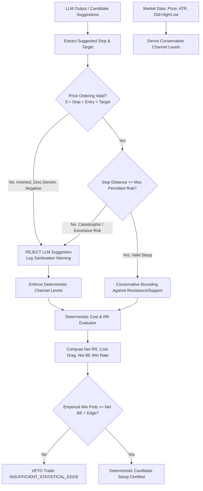

# Specification: Deterministic Trade Geometry and Reward-to-Risk Engine (Step 5.2)

## 1. Overview & Architectural Role

Under the **Recommended Decoupled Architecture**, all execution geometry, price boundaries, reward-to-risk evaluations, and capital allocations are strictly governed by **deterministic functions**. 

While the Large Language Model (LLM) may analyze catalysts, synthesize news, and discuss setup mechanics, **it has zero authority to execute orders, bypass price-ordering checks, or specify unvalidated risk parameters**.

Step 5.2 establishes a mathematically rigorous, deterministic calculation of reward-to-risk from validated prices, explicitly accounting for transaction costs, execution friction, and empirical outcome evidence.

---

## 2. Core Reward-to-Risk Formulations

### 2.1 Long Entry Geometry
For a long position with validated prices satisfying $0 < \text{Stop} < \text{Entry} < \text{Target}$:

$$RR_{\text{long}} = \frac{\text{Target} - \text{Entry}}{\text{Entry} - \text{Stop}} = \frac{\text{Gross Reward}}{\text{Gross Risk}}$$

- **Gross Reward**: $\text{Target} - \text{Entry} > 0$
- **Gross Risk (Denominator)**: $\text{Entry} - \text{Stop} > 0$

### 2.2 Short Entry Geometry
For a short position with validated prices satisfying $0 < \text{Target} < \text{Entry} < \text{Stop}$:

$$RR_{\text{short}} = \frac{\text{Entry} - \text{Target}}{\text{Stop} - \text{Entry}} = \frac{\text{Gross Reward}}{\text{Gross Risk}}$$

- **Gross Reward**: $\text{Entry} - \text{Target} > 0$
- **Gross Risk (Denominator)**: $\text{Stop} - \text{Entry} > 0$

---

## 3. Deterministic Price Ordering & Rejection Invariants

All inputs undergo deterministic price validation before any calculations occur:

| Check | Failure Condition | Status Code | Policy Action |
| :--- | :--- | :--- | :--- |
| **Positive Prices** | $\text{Entry} \le 0 \lor \text{Stop} \le 0 \lor \text{Target} \le 0$ | `NON_POSITIVE_PRICE` | Immediate Reject (`is_valid = False`) |
| **Long Monotonicity** | $\text{Stop} \ge \text{Entry} \lor \text{Target} \le \text{Entry}$ | `INVALID_PRICE_ORDERING` | Immediate Reject (`is_valid = False`) |
| **Short Monotonicity** | $\text{Stop} \le \text{Entry} \lor \text{Target} \ge \text{Entry}$ | `INVALID_PRICE_ORDERING` | Immediate Reject (`is_valid = False`) |
| **Zero/Negative Denominator** | $(\text{Entry} - \text{Stop}) \le 0$ (Long) or $(\text{Stop} - \text{Entry}) \le 0$ (Short) | `ZERO_OR_NEGATIVE_RISK` | Immediate Reject (`is_valid = False`) |
| **Zero/Negative Numerator** | $(\text{Target} - \text{Entry}) \le 0$ (Long) or $(\text{Entry} - \text{Target}) \le 0$ (Short) | `ZERO_OR_NEGATIVE_REWARD` | Immediate Reject (`is_valid = False`) |
| **Excessive Unvalidated Risk** | $\frac{\text{Risk}}{\text{Entry}} > \text{max\_stop\_distance\_pct}$ | `EXCESSIVE_STOP_DISTANCE` | Immediate Reject / Snap to Channel Stop |

---

## 4. Execution Assumptions & Transaction Cost Accounting

Real-world execution experiences friction that reduces upside rewards and expands downside losses. The engine models three primary cost dimensions:

1. **Slippage**: Adverse fill price deviation on market or stop executions (default $5.0 \text{ bps} = 0.05\%$).
2. **Commissions & Regulatory Fees**: Exchange clearing, SEC, and FINRA trading fees (default $1.0 \text{ bps} = 0.01\%$).
3. **Borrow Costs (Shorts)**: Annualized borrow fee accrued over the expected holding duration (default $0.0\%-3.0\%$).

### 4.1 Cost-Adjusted Pricing Equations

#### Long Positions:
$$\text{Effective Entry} = \text{Entry} \times (1 + \text{slippage}) + \text{commission}$$
$$\text{Effective Target} = \text{Target} \times (1 - \text{slippage}) - \text{commission}$$
$$\text{Effective Stop} = \text{Stop} \times (1 - \text{slippage}) - \text{commission}$$

$$\text{Net Reward} = \text{Effective Target} - \text{Effective Entry} = \text{Gross Reward} - \text{Total Friction}_{\text{win}}$$
$$\text{Net Risk} = \text{Effective Entry} - \text{Effective Stop} = \text{Gross Risk} + \text{Total Friction}_{\text{loss}}$$

#### Short Positions:
$$\text{Effective Entry} = \text{Entry} \times (1 - \text{slippage}) - \text{commission}$$
$$\text{Effective Target} = \text{Target} \times (1 + \text{slippage}) + \text{commission}$$
$$\text{Effective Stop} = \text{Stop} \times (1 + \text{slippage}) + \text{commission} + \text{borrow\_fee}$$

$$\text{Net Reward} = \text{Effective Entry} - \text{Effective Target} = \text{Gross Reward} - \text{Total Friction}_{\text{win}}$$
$$\text{Net Risk} = \text{Effective Stop} - \text{Effective Entry} = \text{Gross Risk} + \text{Total Friction}_{\text{loss}}$$

### 4.2 Net Reward-to-Risk Ratio
$$RR_{\text{net}} = \frac{\text{Net Reward}}{\text{Net Risk}} < RR_{\text{gross}}$$

Execution costs systematically compress the reward-to-risk profile:
$$\text{Cost Drag (bps)} = \frac{\text{Gross Reward} - \text{Net Reward}}{\text{Entry}} \times 10,000$$

---

## 5. Break-Even Win Rate & Realized Outcome Justification

### 5.1 Mathematical Break-Even Derivation
Under fixed payoff sizes $R_{\text{win}}$ and $R_{\text{loss}}$, expected payoff per trade is:
$$\mathbb{E}[\text{Payoff}] = (p_{\text{win}} \times R_{\text{win}}) - ((1 - p_{\text{win}}) \times R_{\text{loss}})$$

Setting $\mathbb{E}[\text{Payoff}] = 0$ yields the break-even win rate:
$$\text{WinRate}_{\text{BE}} = \frac{R_{\text{loss}}}{R_{\text{win}} + R_{\text{loss}}} = \frac{1}{1 + \frac{R_{\text{win}}}{R_{\text{loss}}}} = \frac{1}{1 + RR}$$

### 5.2 Pre-Cost vs. Post-Cost Break-Even Comparison
- **Gross 1.20 Ratio**:
  $$\text{WinRate}_{\text{BE, gross}} = \frac{1}{1 + 1.20} = \frac{1}{2.20} \approx 45.45\%$$
- **Net Ratio Post-Cost (e.g. Net RR = 1.15)**:
  $$\text{WinRate}_{\text{BE, net}} = \frac{1}{1 + 1.15} = \frac{1}{2.15} \approx 46.51\%$$

> [!IMPORTANT]
> A reward-to-risk ratio of 1.20 alone does **not** make a trade attractive. A 1.20-to-1 ratio requires at least a 45.5% win rate before costs (and ~46.5% after costs) merely to break even.
> Therefore, the quantitative engine requires explicit evidence that realized trade outcomes justify entering.

### 5.3 Realized Outcome Justification Gate
A setup is justified for execution **only if**:
1. $RR_{\text{gross}} \ge \text{reward\_risk\_minimum}$ ($1.20$).
2. The estimated empirical win probability $p_{\text{win}}$ exceeds $\text{WinRate}_{\text{BE, net}}$ by at least the required statistical edge:
   $$\text{Edge} = p_{\text{win}} - \text{WinRate}_{\text{BE, net}} \ge \text{min\_edge\_pct} \ (2.0\%)$$
3. Mathematical expectation in R-multiples is strictly positive:
   $$\mathbb{E}[R] = (p_{\text{win}} \times RR_{\text{net}}) - (1 - p_{\text{win}}) > 0.0$$

If empirical or composite evidence does not support $p_{\text{win}} \ge \text{WinRate}_{\text{BE, net}} + \text{edge}$, the setup is vetoed (`INSUFFICIENT_STATISTICAL_EDGE`).

---

## 6. Deterministic Production vs. LLM Price Sanitization

### Sanitization Invariants:
- If the LLM discusses a stop above the long entry or below a short entry, it is **instantly stripped**.
- If the LLM discusses a stop exceeding the maximum permitted risk percentage (e.g. 30%), it is **instantly stripped**.
- The execution engine falls back to conservative channel-anchored levels:
  - Long Stop: $\min(\text{price} - 1.5 \times \text{ATR}, \text{low}_{20d} - 0.5 \times \text{ATR})$.
  - Long Target: $\min(\text{price} + 2.5 \times \text{ATR}, \text{high}_{20d} + 0.5 \times \text{ATR})$.
  - Short Stop: $\max(\text{price} + 1.5 \times \text{ATR}, \text{high}_{20d} + 0.5 \times \text{ATR})$.
  - Short Target: $\max(\text{price} - 2.5 \times \text{ATR}, \text{low}_{20d} - 0.5 \times \text{ATR})$.

---

## 7. Verification & Test Suite Summary

The engine is verified by [`tests/test_trade_geometry.py`](file:///home/bhavin-thakkar/gitClient/ai_trader_gemini/tests/test_trade_geometry.py):
- **Long Formula Verification**: Validated $(110 - 100) / (100 - 95) = 2.0$.
- **Short Formula Verification**: Validated $(100 - 92) / (104 - 100) = 2.0$.
- **Ordering Rejections**: Rejection of non-positive prices, inverted stops, inverted targets.
- **Zero Denominator Rejections**: Denominators $\le 0$ fail closed.
- **Cost Drag & Execution Assumptions**: Verified net RR compression, effective entry inflation, net break-even elevation.
- **Break-Even Win Rate Calibration**: Verified $45.45\%$ gross break-even rate for 1.20 RR.
- **Statistical Edge Enforcement**: Rejection of trades lacking statistical expectancy despite nominal 1.20 gross ratio.
- **LLM Price Sanitization Guard**: Neutralization of inverted and excessive candidate prices.
