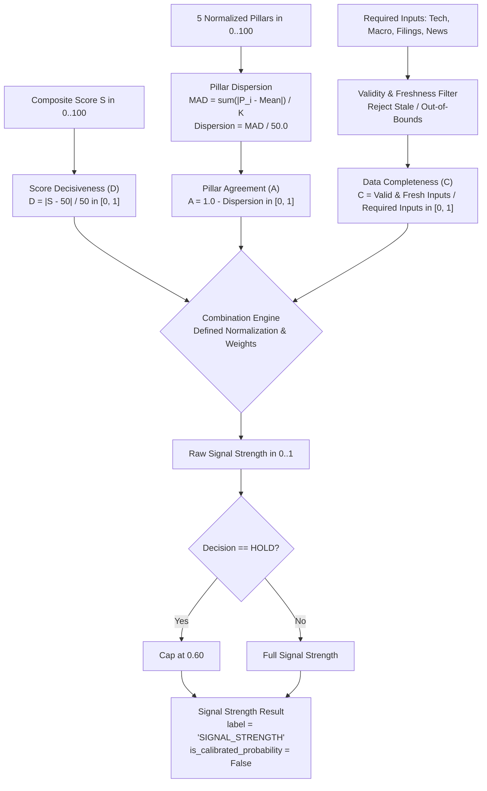

# Specification: Formalized Signal Strength & Confidence Engine (Step 5.5)

## 1. Overview & Epistemic Distinction

A common flaw in algorithmic trading architectures is conflating **internal signal decisiveness and consensus** with **empirical probability of trade profitability**. 

Under Step 5.5, we formalize the exact mathematical formulation of the signal quality index and explicitly define its components:
1. **Score Decisiveness ($D$)**: Measures how far the quantitative composite score is from the neutral midpoint.
2. **Pillar Agreement ($A$)**: Measures cross-sectional dispersion and consensus across the 5 quantitative pillars.
3. **Data Completeness ($C$)**: Measures the percentage of required inputs that are present, valid, and point-in-time fresh.



> [!IMPORTANT]
> **Epistemic Invariant**:
> Until this index is empirically calibrated against realized forward excess return distributions via walk-forward backtests, the result is explicitly designated **Signal Strength** ($\text{SignalStrength} \in [0.0, 1.0]$), **NOT** the empirical probability that a trade will be profitable ($P(\text{Profit} > 0)$).

---

## 2. Mathematical Formulations

### 2.1 Score Decisiveness ($D$)

Let $S \in [0.0, 100.0]$ be the deterministic composite quantitative score. Score decisiveness $D$ measures the normalized distance from the neutral anchor $S_{\text{neutral}} = 50.0$:

$$D = \frac{|S - 50.0|}{50.0}, \quad D \in [0.0, 1.0]$$

#### Boundary & Metric Properties:
- **Neutral Point ($S = 50.0$)**: $D = \frac{|50 - 50|}{50} = 0.00$. Zero directional conviction.
- **Moderate Conviction ($S = 60.0 \text{ or } 40.0$)**: $D = \frac{10}{50} = 0.20$.
- **High Conviction ($S = 70.0 \text{ or } 30.0$)**: $D = \frac{20}{50} = 0.40$.
- **Strong Conviction ($S = 85.0 \text{ or } 15.0$)**: $D = \frac{35}{50} = 0.70$.
- **Maximal Conviction ($S = 100.0 \text{ or } 0.0$)**: $D = \frac{50}{50} = 1.00$.
- **Symmetry**: $D(50 + \delta) = D(50 - \delta) = \frac{\delta}{50}$ for all $\delta \in [0, 50]$. Bullish and bearish deviations are treated with mathematical symmetry.
- **Domain Clamping**: If an unnormalized score $S \notin [0, 100]$ is passed, it is clamped to $[0.0, 100.0]$ prior to calculation.

---

### 2.2 Pillar Agreement ($A$) & Dispersion

Let $P = (P_1, P_2, \dots, P_K)$ be the set of valid, measured quantitative pillar scores ($K \le 5$), where each $P_i \in [0.0, 100.0]$.

The 5 standardized pillars are:
1. `trend` (Price Action & Momentum)
2. `sector` (Sector-Relative Excess Return)
3. `alpha` (Market-Adjusted Alpha)
4. `valuation_history` (Historical Multiple Valuation)
5. `peer_valuation` (Cross-Sectional Peer Multiple Valuation)

#### Dispersion Calculation:
1. **Centroid (Mean)**:
   $$\bar{P} = \frac{1}{K} \sum_{i=1}^K P_i$$

2. **Mean Absolute Deviation (MAD)**:
   $$\text{MAD} = \frac{1}{K} \sum_{i=1}^K |P_i - \bar{P}|$$

3. **Dispersion Normalization**:
   The maximum possible MAD for bounded variables $P_i \in [0, 100]$ occurs when half the pillars equal $0.0$ and half equal $100.0$, yielding $\text{MAD}_{\max} = 50.0$.
   Therefore, the normalized dispersion is:
   $$\text{Dispersion}_{\text{MAD}} = \text{clamp}\left(\frac{\text{MAD}}{50.0}, 0.0, 1.0\right)$$

4. **Pillar Agreement ($A$)**:
   $$A = 1.0 - \text{Dispersion}_{\text{MAD}}, \quad A \in [0.0, 1.0]$$

#### Dispersion Metric Alternatives:
The engine also supports:
- **Standard Deviation ($\sigma$)**:
  $$\sigma = \sqrt{\frac{1}{K} \sum_{i=1}^K (P_i - \bar{P})^2}, \quad \text{Dispersion}_{\sigma} = \text{clamp}\left(\frac{\sigma}{50.0}, 0.0, 1.0\right)$$
- **Range**:
  $$\text{Dispersion}_{\text{range}} = \text{clamp}\left(\frac{\max(P) - \min(P)}{100.0}, 0.0, 1.0\right)$$

#### Missing & Sparse Pillar Handling:
- **$K = 0$ (No Pillars Measured)**: $A = 0.50$ (neutral baseline).
- **$K = 1$ (Single Pillar Measured)**: Cross-sectional consensus cannot be established from a single point $\implies A = 0.50$.
- **$K < 3$ (Fewer than 3 Pillars Measured)**: Triggers Gate 5 missing-data rejection (`DATA_COVERAGE_INADEQUATE`), blocking fresh directional entries.

---

### 2.3 Data Completeness ($C$)

Data completeness $C$ represents the percentage of required system inputs that are present, non-null, within valid physical bounds, and point-in-time fresh.

#### Formal Formulation:
Let $\{x_1, x_2, \dots, x_M\}$ be the set of $M$ required input features across technical, fundamental, macro, and sentiment providers:

$$C = \frac{1}{M} \sum_{j=1}^M \mathbb{I}(x_j \text{ is Available} \land x_j \text{ is Valid} \land x_j \text{ is Fresh}), \quad C \in [0.0, 1.0]$$

Where:
- $\text{Available}(x_j) \iff x_j \neq \text{None}$.
- $\text{Valid}(x_j) \iff x_j$ satisfies domain constraints (e.g., $P > 0, \text{ATR} > 0, S \in [0, 100]$).
- $\text{Fresh}(x_j) \iff \text{Age}(x_j) \le \text{MaxStalenessDays}$ (e.g., $\le 5$ calendar days for market/ML features).

#### Weighted Input Extension:
When inputs carry differential importance weights $w_j \ge 0, \sum w_j = 1.0$:

$$C_{\text{weighted}} = \sum_{j=1}^M w_j \cdot \mathbb{I}(x_j \text{ is Available} \land x_j \text{ is Valid} \land x_j \text{ is Fresh})$$

---

## 3. Normalization, Weights & Combination Methods

All three inputs are strictly normalized to $[0.0, 1.0]$ before combination:
- $D \in [0.0, 1.0]$ (Decisiveness)
- $A \in [0.0, 1.0]$ (Pillar Agreement)
- $C \in [0.0, 1.0]$ (Data Completeness)

The engine provides three formal combination methods:

### Method 1: Hierarchical Gated Model (Production Default)
Preserves exact mathematical continuity with Step 5.3 and the production trading policy:
1. **Edge Strength ($E$)**:
   $$E = w_D \cdot D + w_A \cdot (A - 0.50)$$
   With default weights $w_D = 0.70$ and $w_A = 0.30$. Agreement modulates directional conviction by $\pm 0.15$.
2. **Base Signal Strength ($B$)**:
   $$B = 0.50 + 0.50 \cdot E, \quad B \in [0.0, 1.0]$$
3. **Completeness Scaling**:
   $$SS_{\text{raw}} = B \cdot (0.50 + 0.50 \cdot C)$$
   Incomplete data imposes up to a $50\%$ haircut on signal strength.

### Method 2: Direct Linear Weighted Combination
$$SS_{\text{linear}} = w_D \cdot D + w_A \cdot A + w_C \cdot C$$
Where $w_D = 0.50, w_A = 0.25, w_C = 0.25$ (sum = $1.00$).

### Method 3: Geometric Multiplicative Combination
$$SS_{\text{geom}} = D^{w_D} \cdot A^{w_A} \cdot C^{w_C}$$
Where $w_D = 0.50, w_A = 0.25, w_C = 0.25$. Penalizes severe deficits in any dimension (zero completeness zeroes out the signal).

### Decision Capping
If the resolved candidate decision is `HOLD`:
$$SS_{\text{final}} = \min(SS_{\text{raw}}, 0.60)$$
Neutral, non-directional signals can never carry directional conviction.

---

## 4. Signal Strength Result Schema

Every evaluation produces a structured audit record:

```python
@dataclass
class SignalStrengthResult:
    signal_strength: float                  # Final rounded value in [0.0, 1.0]
    raw_signal_strength: float              # Unrounded continuous value
    score_decisiveness: float               # D = |S - 50| / 50
    pillar_agreement: float                 # A = 1.0 - Dispersion
    pillar_dispersion: float                # Normalized dispersion in [0.0, 1.0]
    data_completeness: float                # C in [0.0, 1.0]
    valid_pillars_count: int                # Number of measured pillars (0 to 5)
    total_pillars_count: int                # 5
    combination_method: CombinationMethod   # HIERARCHICAL_GATED, LINEAR_WEIGHTED, GEOMETRIC
    decision: str                           # BUY, SELL, HOLD
    is_calibrated_probability: bool = False # Explicitly False until backtested
    label: str = "SIGNAL_STRENGTH"          # Disallows calling this "win probability"
    calibration_status: str = "UNCALIBRATED_HEURISTIC_INDEX"
    metrics: Dict[str, Any]
    input_records: List[Dict[str, Any]]
```

---

## 5. Verification Matrix

| Test Case | Condition | Expected Result | Status |
| :--- | :--- | :--- | :--- |
| `test_score_decisiveness_neutral_boundary` | $S = 50.0$ | $D = 0.00$ | ✅ PASS |
| `test_score_decisiveness_graduated_values` | $S \in \{60, 70, 85, 100, 0\}$ | $D \in \{0.20, 0.40, 0.70, 1.00, 1.00\}$ | ✅ PASS |
| `test_score_decisiveness_symmetry` | $D(50 + x) == D(50 - x)$ | Bull/bear distance parity | ✅ PASS |
| `test_pillar_agreement_perfect_consensus` | All pillars equal $80.0$ | $\text{MAD} = 0.0, A = 1.00$ | ✅ PASS |
| `test_pillar_agreement_moderate_dispersion` | Pillars $[70, 75, 80]$ | $\text{MAD} = 3.33, A = 0.9333$ | ✅ PASS |
| `test_pillar_agreement_severe_dispersion` | Pillars $[0, 0, 100, 100]$ | $\text{MAD} = 50.0, A = 0.00$ | ✅ PASS |
| `test_data_completeness_from_fresh_input_records` | 3 fresh, 1 stale input | $C = 0.75$ | ✅ PASS |
| `test_data_completeness_weighted_inputs` | Weights $0.50, 0.25$ valid, $0.25$ invalid | $C = 0.75$ | ✅ PASS |
| `test_combination_hierarchical_gated_exact_math` | $S=80, A=1.0, C=1.0$ | $\text{Conf} = 0.78$ | ✅ PASS |
| `test_combination_linear_weighted_exact_math` | $D=0.60, A=1.0, C=1.0$ | $\text{Signal} = 0.80$ | ✅ PASS |
| `test_neutral_hold_decision_capping` | Score $90.0$, `decision == "HOLD"` | Capped at $0.60$ | ✅ PASS |
| `test_epistemic_labeling_and_calibration_distinction` | Audit metadata verification | `label == "SIGNAL_STRENGTH"`, `is_calibrated == False` | ✅ PASS |
