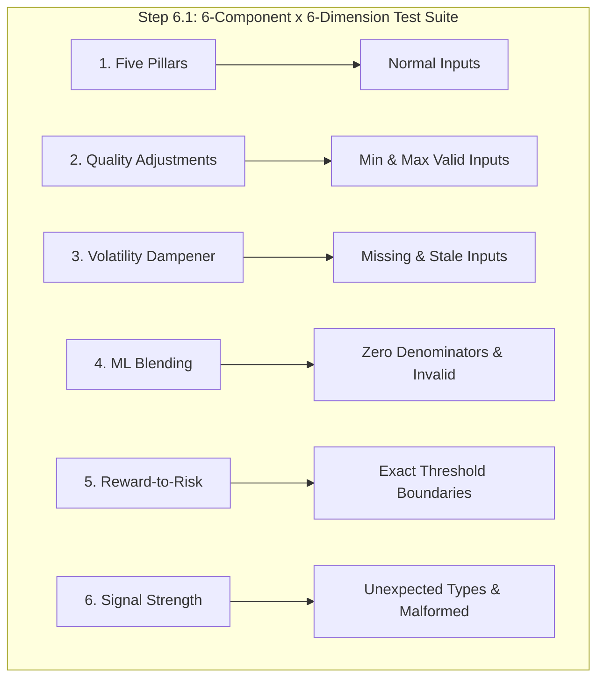
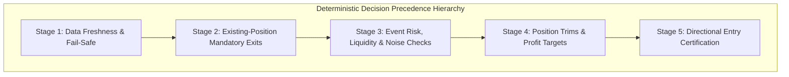
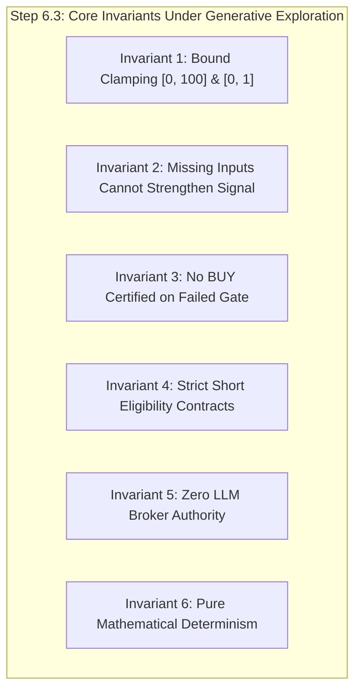
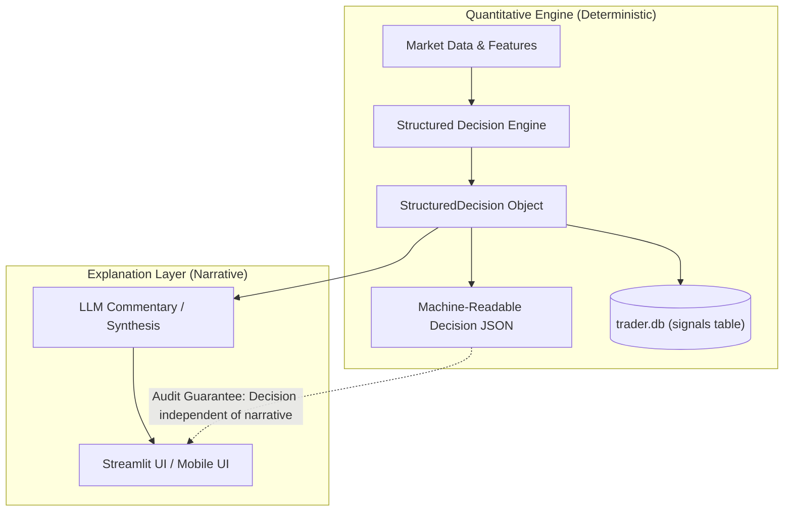

# Specification: Automated Testing and Mathematical Verification (Step 6.1)

## 1. Overview & Mandate

Before connecting the decision engine to any real-time broker execution endpoint or live market-data streaming provider, every mathematical sub-component must be rigorously, deterministically, and automatically verified.

Relying on manual UI inspection in Streamlit or mobile apps or inspecting a handful of historical tickers is strictly prohibited. The quantitative decision engine is designed to be fully testable **offline, without running the LLM, without network calls, and without mock API dependencies.**



---

## 2. Mathematical Components Tested

The test suite in [`tests/test_math_components.py`](file:///home/bhavin/Desktop/git/ai_trader_gemini/tests/test_math_components.py) covers all six components across six mandatory test dimensions:

### 2.1 Component 1: The Five Pillars
Implemented in [`quant/pillar_scores.py`](file:///home/bhavin/Desktop/git/ai_trader_gemini/quant/pillar_scores.py) and [`quant/factors.py`](file:///home/bhavin/Desktop/git/ai_trader_gemini/quant/factors.py):
1. **Trend Pillar (25%)**:
   - `compute_ema_alignment`: Price alignment across EMA20, EMA50, EMA200 with ATR-normalized slope adjustment.
   - `compute_rsi_velocity`: Multi-regime momentum acceleration ($50 \le \text{RSI} \le 68$), mean-reversion bounce ($\text{RSI} < 32$), overbought exhaustion ($\text{RSI} > 75$), and neutral accumulation ($40 \le \text{RSI} < 50$).
   - Rejection of non-positive prices ($\le 0$) and negative indicators.
2. **Sector Relative Pillar (20%)**:
   - `compute_sector_excess`: Multi-horizon weighting ($20\% \times \Delta_{5d} + 50\% \times \Delta_{20d} + 30\% \times \Delta_{60d}$).
   - Dynamic fallback across available horizons.
   - Logistic sigmoid normalization centred at $0.0$ excess return ($\text{Score} = 50.0$).
3. **Market Alpha Pillar (20%)**:
   - `compute_market_alpha`: Multi-horizon Jensen's alpha relative to S&P 500 (`SPY`) and trailing beta covariance.
   - Logistic scaling centred at $0.0$ excess ($\text{Score} = 50.0$).
4. **Valuation History Pillar (15%)**:
   - Continuous Yield Space formulations: $\text{Earnings Yield} = E/P = 1 / \text{PE}$.
   - Time-series percentile ranking over trailing historical quarters ($\ge 8$ observations).
   - Heuristic expansion fallback when historical depth is limited.
5. **Peer Valuation Pillar (20%)**:
   - Cross-sectional robust z-score: $z = (x - \text{median}) / (1.4826 \times \text{MAD})$.
   - Normal CDF scaling: $\text{Score} = 100 \times \Phi(z)$.
   - Cash-heavy fallback: EV $\le 0$ falls back to Market Capitalization.

### 2.2 Component 2: Quality Adjustments & Solvency Gates
Implemented in [`quant/quality_adjustments.py`](file:///home/bhavin/Desktop/git/ai_trader_gemini/quant/quality_adjustments.py):
1. **Financial Quality Scoring ($0$ to $100$)**:
   - FCF Margin: $\ge 20\%$ (+15 pts), $\ge 10\%$ (+8 pts), $\ge 0\%$ (+3 pts), $< 0\%$ (-15 pts & cash burn flag).
   - Operating Margin: $\ge 25\%$ (+10 pts), $\ge 12\%$ (+5 pts), $< 0\%$ (-10 pts).
   - Solvency: Net Cash balance (+15 pts fortress balance sheet); Net Debt/EBITDA $\le 1.5$ (+8 pts), $\le 3.0$ (0 pts), $\le 4.5$ (-10 pts), $> 4.5$ (-20 pts).
   - Interest Coverage: Net Cash (+10 pts); $\ge 8.0$ (+10 pts), $\ge 3.5$ (+5 pts), $\ge 1.5$ (-5 pts), $< 1.5$ (-15 pts).
   - Earnings Quality: OCF / Net Income $\ge 1.1$ (+10 pts), $< 0.5$ (-12 pts accrual divergence).
   - Share Dilution: $> 5.0\%$ (-8 pts).
2. **Compounder Bonus**: Score $\ge 80.00$ earns $+3.0$ points bonus.
3. **Value Trap Hard Eligibility Gate (Rule `FQ-VETO-01`)**:
   - Cheap valuation (Forward P/E $< 15.0$ or peer discount $\ge 20\%$) combined with structural distress (distressed debt $> 3.5\times$, negative FCF, interest coverage $< 2.0\times$, or low quality $< 40$) certifies Value Trap.
   - Design B: Mechanically sets `is_buy_eligible = False` without arbitrary score deductions, preventing double-counting.

### 2.3 Component 3: Volatility Transformation
Implemented in [`quant/volatility.py`](file:///home/bhavin/Desktop/git/ai_trader_gemini/quant/volatility.py):
1. **Deterministic ATR% Factor Bands**:
   $$\text{ATR\%} = \frac{\text{ATR}_{14}}{\text{Price}} \times 100$$
   - $\le 1.5\%$ (Calm): $f_{\text{vol}} = 1.00$
   - $\le 2.5\%$ (Normal): $f_{\text{vol}} = 0.95$
   - $\le 4.0\%$ (Elevated): $f_{\text{vol}} = 0.90$
   - $> 4.0\%$ (Extreme Volatility): $f_{\text{vol}} = 0.85$
2. **Centered Volatility Dampening**:
   $$Q_{\text{final}} = 50.0 + (Q_{\text{adjusted}} - 50.0) \times f_{\text{vol}}$$
   - **Neutral Invariance Property**: For any $f_{\text{vol}} \in [0.0, 1.0]$, $Q_{\text{final}}(50.00) \equiv 50.00$. Neutral signals are mathematically guaranteed never to convert into false buy or sell signals.
   - Symmetric conviction dampening on long ($> 50$) and short ($< 50$) candidates.

### 2.4 Component 4: ML Blending & Composite Pipeline
Implemented in [`quant/composite_score.py`](file:///home/bhavin/Desktop/git/ai_trader_gemini/quant/composite_score.py):
1. **Model Scope Contracts (Rule `ML-SEM-02`)**:
   - In-scope tickers: Linear blend with configured weight (e.g. 70% ML, 30% Quant under Experiment D).
   - Out-of-scope tickers (`OUT_OF_SCOPE`, `STALE_SCORE`, `SCHEMA_MISMATCH`): Strictly assigned `ml_weight = 0.0` and `ml_score = None`. The decision composite is 100% pure deterministic quant score.
2. **Minimum Information Hurdle**:
   - Minimum 3 of 5 pillars must be valid. If $< 3$ pillars are available, pipeline aborts with `INSUFFICIENT_EVIDENCE` and composite score = `None`.
3. **Score Threshold Boundaries**:
   - **60.00 vs 59.99**: Score $\ge 60.00$ classifies as "Strong Bullish Quant Signal (BUY candidate)"; score $59.99$ falls into "Neutral / Mixed Quant Signal (HOLD candidate)".
   - **45.00 vs 44.99**: Score $\ge 45.00$ is Neutral / Mixed; score $44.99$ is Bearish / Overvalued.

### 2.5 Component 5: Reward-to-Risk & Trade Geometry
Implemented in [`quant/trade_geometry.py`](file:///home/bhavin/Desktop/git/ai_trader_gemini/quant/trade_geometry.py):
1. **Price Ordering & Invariants**:
   - Long: $0 < \text{Stop} < \text{Entry} < \text{Target}$.
   - Short: $0 < \text{Target} < \text{Entry} < \text{Stop}$.
   - Denominator ($\text{Entry} - \text{Stop}$ for long; $\text{Stop} - \text{Entry}$ for short) must be strictly $> 0$.
   - Rejects non-positive prices, inverted sequences, zero risk denominators, and excessive stop distances ($> 30\%$).
2. **Execution Friction & Cost Drag Accounting**:
   - Deducts slippage (5 bps) and commissions (1 bps) on both entry and exit legs.
   - Effective net reward and net risk computed; verifies that transaction costs do not eliminate edge.
3. **Threshold Boundaries**:
   - Gross RR of **1.20** meets threshold (`meets_min_rr = True`); Gross RR of **1.199** fails (`meets_min_rr = False`).
   - Short Gross RR threshold: **1.50**.
   - Net break-even win rate: $\text{BE}_{\text{net}} = 1 / (1 + \text{RR}_{\text{net}})$.
   - Statistical edge: estimated empirical win probability must clear net break-even win rate by $\ge 2.0\%$ margin ($p_{\text{win}} - \text{BE}_{\text{net}} \ge 0.02$) with strictly positive expectancy $\mathbb{E}[R] > 0$.

### 2.6 Component 6: Confidence & Signal Strength
Implemented in [`quant/signal_strength.py`](file:///home/bhavin/Desktop/git/ai_trader_gemini/quant/signal_strength.py):
1. **Score Decisiveness ($D$)**:
   $$D = \frac{|S - 50.0|}{50.0} \in [0.0, 1.0]$$
   - Strict mathematical symmetry: $D(50 + x) \equiv D(50 - x)$.
   - Neutral anchor $S=50.0 \implies D=0.0000$.
   - Boundary extremes $S \in \{0, 100\} \implies D=1.0000$.
2. **Pillar Agreement ($A$)**:
   $$A = 1.0 - \text{clamp}\left(\frac{\text{MAD}}{50.0}, 0.0, 1.0\right)$$
   - Full consensus (identical scores) $\implies A = 1.00$.
   - Theoretical maximum dispersion ($[0, 0, 100, 100]$) $\implies A = 0.00$.
   - Single pillar defaults to neutral $0.50$ baseline.
3. **Data Completeness ($C$)**:
   - Percentage of required inputs available, valid, and point-in-time fresh. Stale or invalid inputs are excluded from numerator.
4. **Epistemic HOLD Ceiling**:
   - Non-directional `HOLD` decisions are capped at exactly $0.60$ (`hold_ceiling`), preventing non-directional uncertainty from falsely presenting high confidence.
   - Directional entry threshold requires $\text{Signal Strength} \ge 0.65$.

---

---

## 3. Step 6.2: Mandatory Decision Scenarios & Regression Suite

Implemented in [`tests/test_mandatory_decision_scenarios.py`](file:///home/bhavin/Desktop/git/ai_trader_gemini/tests/test_mandatory_decision_scenarios.py).

Every decision branch is protected against accidental regressions, edge-case leaks, and unauthorized execution authority:



### 3.1 The 10 Mandatory Decision Scenarios

| Scenario # | Condition / Trigger | Policy Mandate | Verification in Suite |
|---|---|---|---|
| **1** | Score is `59.99`, ordinary BUY floor at `60.00` | **Do not BUY**. Downgrade to `HOLD`. Score `60.00` clears floor. | Verified in `BuyFloorGate` and `DecisionPrecedenceEngine` with `COMPOSITE_BELOW_FLOOR`. |
| **2** | Score is `52.00`, but fails separately defined dip-buy criteria (e.g. RSI $> 45$, 5d drop $< 5\%$, valuation history $< 60$, or confirmed Value Trap) | **Do not BUY**. Reverts to standard `60.00` floor; fails entry. | Verified across 4 failure modes (RSI, drawdown, valuation, trap) and verified pass when all criteria met. |
| **3** | LLM proposes `BUY`, but reward-to-risk fails ($< 1.20$) or price ordering is invalid (target $\le$ entry) | **Do not BUY**. Advisory proposal rejected and converted to `HOLD`. | Verified in `RewardToRiskGate` (`RR_TOO_LOW` and `ZERO_OR_NEGATIVE_REWARD`). |
| **4** | Composite score is high ($85.0$), but earnings blackout active ($\le 3$ sessions) | **Block new entry**. Binary gap risk takes absolute precedence over score. | Verified in `VolatilityEventLiquidityGate` and Stage 3 with `EARNINGS_BLACKOUT`. |
| **5** | Existing long hits valid stop loss while composite score remains high ($85.0$) | **Execute exit policy**. The Holding-Thesis Guard **cannot** intercept a mandatory stop breach. | Verified in Stage 2 mandatory risk controls with `STOP_LOSS_BREACH`. |
| **6** | ML data is stale (`STALE_SCORE` / `ml_data_fresh=False`) | **Use approved fallback** (`ml_weight=0.0`, 100% quant); otherwise block entry if fail-closed. | Verified in `blend_quant_and_ml_scores` and Stage 1 outage fail-safe. |
| **7** | Ticker is outside ML universe (`OUT_OF_SCOPE`) | Ensure ML weight is `0.0` and quant-only fallback applies. | Verified in `blend_quant_and_ml_scores`: `comp == quant_score`, `ml_weight == 0.0`. |
| **8** | LLM returns invalid JSON, broker commands, or unsupported actions | **Reject proposal**. Never issue an order. | Verified via `validate_signal_json` rejecting non-dict payloads, broker commands, and unsupported actions. |
| **9** | Short signal passes breakdown score ($\le 45.0$), but borrow pool is unavailable | **Block short entry**. Downgrade to `HOLD`. Certify short order only when borrow is available. | Verified in `SellExitSymmetryGate` and precedence engine: `BORROW_UNAVAILABLE` vs `SHORT_ORDER_CERTIFIED`. |
| **10** | Market data is stale or contradictory | **Block new entries**; trigger protective liquidation if outage duration exceeds tolerance. | Verified in Stage 1 fail-safe: `DATA_OUTAGE_NEW_ENTRIES_BLOCKED` and `DATA_OUTAGE_PROTECTIVE_LIQUIDATION`. |

---

### 3.2 End-to-End Pipeline Integration Test

Covered by `TestEndToEndPipelineIntegration.test_end_to_end_data_to_decision_and_db_persistence`:

1. **Raw Market Data Ingestion**: Ingests realistic market metrics (`current_price=400.0`, `ema20=395.0`, `ema50=390.0`, `ema200=370.0`, `rsi14=58.0`, `atr=6.0`, `suggested_stop_loss=392.0`, `suggested_target_price=435.0`, `rvol_20d=1.25`, `avg_dollar_vol_20d=50_000_000.0`, `days_to_earnings=45`).
2. **Fundamentals & Sector Benchmarks**: Ingests Gloomberb key financial ratios, balance sheet quality (fortress net cash), and peer EV/EBITDA benchmarks.
3. **Deterministic Quantitative Composite**: Computes 5-pillar composite score ($> 60.0$) with 100% data completeness ($5/5$ pillars).
4. **ML Blending**: Blends with in-scope ML score ($85.0$) at 70% ML weight.
5. **Auditable Evidence Records**: Assembles point-in-time SEC EDGAR 10-Q evidence record with publication, availability, and retrieval timestamps.
6. **Strict Evidence Contract**: Validates LLM output against the strict `LLMEvidenceAnalysis` schema (forbidding broker commands, validating ISO 8601 timestamps, catalysts, and document citation provenance).
7. **Signal Bridging & Compliance Gate Execution**: Normalizes signal via `normalize_master_trader_json`, certifying `decision="BUY"` with validated $RR \ge 1.20$.
8. **Database Persistence**: Persists certified signal into SQLite `signals` table and associated evidence into `rag_evidence_records` table.
9. **Persistence & Schema Verification**: Queries SQLite database to confirm complete row integrity, numerical precision, and foreign key linkage.

---

## 4. Step 6.3: Property-Based Tests & Invariant Verification

Implemented in [`tests/test_property_based_invariants.py`](file:///home/bhavin/Desktop/git/ai_trader_gemini/tests/test_property_based_invariants.py).

To prevent overfitting to discrete examples or handpicked inputs, the decision engine is subjected to automated generative property-based testing powered by `Hypothesis`.
Every property test runs with `@seed(42)` and `@settings(max_examples=100, deadline=None)` to guarantee 100% deterministic reproducibility across runs, while preserving explicit historical regression boundaries via `@example(...)`.



### 4.1 Invariant 1: Quantitative & Hybrid Scores Strictly Remain in Bounds
- **Property**: For any valid, invalid, infinite, or extreme floating point input $x \in [-\infty, +\infty]$, all scaled scores, damped scores, and blended composites satisfy:
  $$S \in [0.0, 100.0], \quad f_{\text{vol}} \in [0.0, 1.0]$$
- **Components Verified**:
  - `clamp(val, min_val, max_val)`: strictly outputs $v \in [\text{min\_val}, \text{max\_val}]$ even when $x = \text{NaN}$ or $x = \pm\infty$.
  - `logistic_scale` & `normal_cdf_scale`: strictly in $[0.0, 100.0]$.
  - `compute_vol_factor`: strictly in $[0.0, 1.0]$ across arbitrary prices and ATR values.
  - `apply_volatility_dampener`: preserves $[0.0, 100.0]$ bounds and confirms **Neutral Invariance** ($50.00 \to 50.00$).
  - `blend_quant_and_ml_scores`: composite score always bounded in $[0.0, 100.0]$ across arbitrary quant scores, ML scores, and blend weights.

### 4.2 Invariant 2: Missing Inputs Cannot Strengthen Signal
- **Property**: Omitting data, generating incomplete inputs, or encountering data outages cannot artificially inflate confidence or bypass information hurdles:
  $$\frac{\partial \, \text{Signal Strength}}{\partial \, C} \ge 0$$
- **Components Verified**:
  - `calculate_signal_strength`: strictly non-decreasing with data completeness ($C_{\text{full}} \ge C_{\text{sparse}} \implies SS(C_{\text{full}}) \ge SS(C_{\text{sparse}})$).
  - `InsufficientPillarsGate`: whenever available pillars $< 3$, the gate unconditionally aborts with `is_passed = False` and `status_code = "INSUFFICIENT_PILLARS"`.

### 4.3 Invariant 3: No BUY is Certified When a Mandatory Gate Has Failed
- **Property**: If any mandatory BUY condition is violated, the decision engine mathematically *cannot* output `InternalActionType.BUY`:
  $$\exists \, g \in \text{Gates}_{\text{mandatory}} \text{ s.t. } \text{failed}(g) \implies \text{Decision} \neq \text{BUY}$$
- **Scenarios Explored via Generators & Explicit Examples**:
  - Scores below BUY floor ($S \in [0.0, 59.99]$) without meeting all dip-buy criteria.
  - Scores in dip-buy zone ($S \in [50.0, 59.99]$) with failed RSI, failed drop, failed valuation, or value trap flag.
  - Earnings blackout active ($\text{days\_to\_earnings} \in [0, 3]$).
  - Stale market data or data outage.
  - Invalid, sub-threshold ($RR < 1.20$), or inverted reward-to-risk geometry ($\text{target} \le \text{entry}$ or $\text{entry} \le \text{stop}$).

### 4.4 Invariant 4: No Short is Opened Without Passing Short Eligibility Checks
- **Property**: Directional short entry (`InternalActionType.OPEN_SHORT`) is strictly forbidden unless all short eligibility conditions are satisfied:
  $$\text{Action} = \text{OPEN\_SHORT} \implies (S \le 45.0 \land \text{borrow\_avail} = \text{True} \land \text{div\_days} > 3 \land \text{pos} \neq \text{LONG})$$
- **Generators Verified**:
  - Unborrowable shares (`borrow_available = False`) downgrade to `HOLD`.
  - Non-breakdown scores ($S \in [45.01, 100.0]$) cannot short.
  - Ex-dividend binary blackout ($\text{days\_to\_dividend} \in [0, 3]$) blocks short opening.
  - Existing long position closure emits `SELL_TO_CLOSE`, never `OPEN_SHORT`.

### 4.5 Invariant 5: Malformed LLM Output Cannot Authorize an Order
- **Property**: The LLM acts exclusively as an unprivileged, qualitative evidence analyst. If an LLM response contains execution commands, trading verbs, or unsupported action strings, the proposal is rejected fail-closed and no order can ever be authorized:
  $$\text{ForbiddenCommandPresent}(\text{payload}) \lor \text{Action} \notin \{\text{BUY}, \text{SELL}, \text{HOLD}\} \implies \text{OrderAuthorized} = \text{False}$$
- **Generators Verified**:
  - Injected prohibited broker keys (`shares`, `quantity`, `execute_now`, `broker_action`, `order_type`, `limit_price`, `stop_price`, `time_in_force`, `portfolio_pct`, `account_id`, `route`, `leverage_ratio`, `margin_enabled`) are detected and stripped/rejected.
  - Unsupported actions (e.g. `SCALE_IN`, `DOUBLE_DOWN`, `AGGRESSIVE_BUY`, `YOLO`) fail validation.

### 4.6 Invariant 6: Determinism & Idempotence
- **Property**: Identical input records, market features, and configuration parameters evaluated multiple times across random orders produce exact bitwise identical decisions:
  $$f(x, \theta) \equiv f(x, \theta)$$
- **Verified**:
  - `DecisionPrecedenceEngine.evaluate()` is purely deterministic and stateless.
  - `calculate_signal_strength()` is mathematically idempotent.

---

## 5. Code Hardening Uncovered by Property Testing

Generative property exploration revealed and fixed edge-case vulnerabilities in production code:

1. **`quant/normalization.py`**:
   - *Issue*: `clamp(val, min_val, max_val)` defaulted NaN fallback to hardcoded `50.0`. When `min_val > 50.0` (e.g. `clamp(nan, 51.0, 100.0)`), the returned value `50.0` violated the minimum constraint.
   - *Fix*: Clamped fallback default to `max(min_val, min(max_val, 50.0))`.
2. **`quant/composite_score.py`**:
   - *Issue*: Floating point precision or out-of-range ML weights could permit slight boundary overshoot in `blend_quant_and_ml_scores`.
   - *Fix*: Strictly clamped `ml_w` to `[0.0, 1.0]` and output composite to `[0.0, 100.0]`.
3. **`llm_evidence_schema.py`**:
   - *Issue*: LLMs could attempt unauthorized broker execution via synonyms or secondary parameters (`broker_action`, `account_id`, `route`, `portfolio_pct`, `time_in_force`).
   - *Fix*: Expanded `FORBIDDEN_BROKER_FIELDS` to intercept all execution verbs, sizing directives, account routing, and order constraint keys.

---

## 6. Test Suite Health & Intermediate Verification Results

The automated regression test suite executes cleanly and deterministically:

1. **Step 6.1 Unit Tests (`tests/test_math_components.py`)**:
   - **47 PASSED** in 0.27s.
2. **Step 6.2 Scenario Regression & Integration Tests (`tests/test_mandatory_decision_scenarios.py`)**:
   - **17 PASSED** in 3.18s.
3. **Step 6.3 Property-Based Invariant Tests (`tests/test_property_based_invariants.py`)**:
   - **20 PASSED** in 4.34s (over 2,000 generated examples verified).

---

## 7. Step 6.4: Separation of the Decision from the Explanation

### 7.1 Architecture & Contract Specification

To ensure auditability, regulatory compliance, and deterministic execution, the quantitative decision engine maintains complete independence between the trade decision and any natural language narrative rendered by LLMs or displayed in Streamlit/Mobile UIs.

The decision engine produces a canonical machine-readable JSON structure matching the contract:

```json
{
  "run_id": "example-run-id",
  "ticker": "NVDA",
  "decision": "HOLD",
  "composite_score": 58.4,
  "model_status": "IN_SCOPE",
  "passed_gates": ["EVENT_RISK", "LIQUIDITY"],
  "failed_gates": ["BUY_FLOOR"],
  "data_quality_status": "VALID",
  "position_action": "NO_ACTION",
  "reason_codes": ["SCORE_BELOW_BUY_THRESHOLD"]
}
```



### 7.2 Structured Enumerations & Controlled Vocabularies

All fields are strictly bounded by typed enumerations in [`quant/structured_decision.py`](file:///home/bhavin/Desktop/git/ai_trader_gemini/quant/structured_decision.py):

1. **Position Action (`PositionAction`)**:
   - `NO_ACTION`: Maintain flat or existing position state.
   - `OPEN_LONG`: Certified new long entry.
   - `CLOSE_LONG`: Mandatory liquidation of existing long (stop breach, target hit, evidence veto).
   - `OPEN_SHORT`: Certified new short entry.
   - `CLOSE_SHORT`: Mandatory liquidation of existing short.
   - `TRIM_LONG`: Partial de-risking.

2. **Data Quality Status (`DataQualityStatus`)**:
   - `VALID`: Full market, quote, and pillar data present.
   - `PARTIAL`: Graceful fallback with $< 5$ but $\ge 3$ pillars.
   - `STALE`: Outdated quotes or market data feed.
   - `OUTAGE`: Active vendor feed disruption.
   - `INSUFFICIENT_DATA`: $< 3$ pillars or unmodeled data.

3. **Model Scope Status (`ModelScopeStatus`)**:
   - `IN_SCOPE`: Ticker covered by trained ML model and fresh predictions.
   - `OUT_OF_SCOPE`: Quant-only fallback applied (ML weight = 0.0).
   - `STALE_SCORE`: Outdated inference timestamp.
   - `SCHEMA_MISMATCH`: Feature dimension or model revision conflict.
   - `UNMODELED`: Missing model weights.

4. **Standard Gate Names (`StandardGateName`)**:
   - `DATA_QUALITY`: Instrument eligibility, freshness, and outage tolerances.
   - `STOP_LOSS_SURVEILLANCE`: Stop loss monitoring on active holdings.
   - `HOLDING_THESIS`: Protection of intact winning positions.
   - `PROFIT_TARGET`: Target exit criteria.
   - `EVENT_RISK`: Earnings blackout and corporate binary event controls.
   - `LIQUIDITY`: Turnover (RVOL) and average dollar volume thresholds.
   - `BUY_FLOOR`: Minimum composite score and dip-buy criteria.
   - `SHORT_CEILING`: Maximum score ceiling for short entries.
   - `BORROW_AVAILABILITY`: Locate confirmation for short sales.
   - `REWARD_TO_RISK`: Geometry, positive risk, and net RR hurdles.
   - `CONFIDENCE_HURDLE`: Minimum signal strength verification.

5. **Standard Reason Codes (`StandardReasonCode`)**:
   - Controlled machine-readable strings eliminating reliance on free-form narrative text:
     - `SCORE_BELOW_BUY_THRESHOLD`, `DIP_CRITERIA_FAILED`, `VALUE_TRAP_DETECTED`
     - `SHORT_CEILING_EXCEEDED`, `BORROW_UNAVAILABLE`
     - `EARNINGS_BLACKOUT_ACTIVE`, `EVENT_RISK_BLACKOUT`, `EX_DIVIDEND_BLACKOUT`
     - `LIQUIDITY_INSUFFICIENT`, `STOP_INSIDE_VOLATILITY_NOISE`
     - `REWARD_TO_RISK_INSUFFICIENT`, `PRICE_ORDERING_INVALID`, `NEGATIVE_OR_ZERO_RISK`
     - `STOP_LOSS_BREACHED`, `SHORT_STOP_BREACHED`, `PROFIT_TARGET_REACHED`
     - `HOLDING_THESIS_INTACT`, `THESIS_COLLAPSED`, `CRITICAL_EVIDENCE_VETO`
     - `DATA_OUTAGE_BLOCK`, `DATA_OUTAGE_FAILSAFE_EXIT`, `STALE_MARKET_DATA`
     - `INSUFFICIENT_PILLARS`, `CONFIDENCE_BELOW_HURDLE`
     - `BUY_ORDER_CERTIFIED`, `SHORT_ORDER_CERTIFIED`, `NO_ACTION_DEFAULT`

### 7.3 Database Persistence & UI Integration

In [`db.py`](file:///home/bhavin/Desktop/git/ai_trader_gemini/db.py):
- The `signals` table schema has been updated with explicit structured columns:
  - `run_id`, `model_status`, `passed_gates`, `failed_gates`, `data_quality_status`, `position_action`, `reason_codes`, and `structured_decision`.
- Auto-migration dynamically adds missing columns to existing SQLite databases without schema corruption.
- Round-trip deserialization ensures that UI queries via `get_latest_signals()` automatically deserialize JSON lists and dictionaries.

In [`main.py`](file:///home/bhavin/Desktop/git/ai_trader_gemini/main.py):
- `normalize_master_trader_json` delegates decision derivation to `quant.structured_decision.build_structured_decision`, ensuring the UI displays exact programmatic reason codes.

### 7.4 Verification Suite & Test Coverage

The test suite in [`tests/test_structured_decision.py`](file:///home/bhavin/Desktop/git/ai_trader_gemini/tests/test_structured_decision.py) covers:
1. **Mandatory Gate Verification**: Every standard gate tested with normal and failure inputs.
2. **Decision/Explanation Separation**: Asserting identical decisions whether narrative is present or absent.
3. **Reproducibility of Logged Reasons**: 50 consecutive deterministic evaluations producing 100% bitwise identical gate outcomes and reason codes.
4. **SQLite Round-Trip Persistence**: Full database insert, query, and dictionary enrichment verification.

---

## 8. Final Test Suite Health & Verification Results

The automated regression test suite executes cleanly and deterministically:

1. **Step 6.1 Unit Tests (`tests/test_math_components.py`)**:
   - **47 PASSED** in 0.27s.
2. **Step 6.2 Scenario Regression & Integration Tests (`tests/test_mandatory_decision_scenarios.py`)**:
   - **17 PASSED** in 3.18s.
3. **Step 6.3 Property-Based Invariant Tests (`tests/test_property_based_invariants.py`)**:
   - **20 PASSED** in 4.34s (over 2,000 generated examples verified).
4. **Step 6.4 Structured Decision Tests (`tests/test_structured_decision.py`)**:
   - **19 PASSED** in 3.31s.
5. **Pytest Suite (`tests/`)**:
   - **247 PASSED, 1 SKIPPED** in 5.44s.
6. **Full Repository Pytest (`pytest`)**:
   - **502 PASSED, 1 SKIPPED** in 8.40s.
7. **Repository Unittest Discovery (`python -m unittest discover`)**:
   - **274 PASSED, 0 FAILED** in 2.65s.
