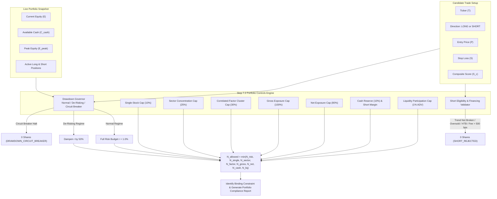

# Specification: Portfolio-Level Risk Controls & Concentration Management (Step 7.2)

## 1. Overview & Institutional Mandate

In quantitative swing trading, individual stock attractiveness (high composite scores or favorable qualitative catalysts) does not dictate portfolio sizing. Several individually attractive stocks may form an unbalanced or catastrophic portfolio if their sizing is unconstrained, if they share excessive sector correlation, or if they breach the firm's aggregate risk budget.

In our **25-stock ETF leader universe**, concentration analysis is particularly vital: multiple stocks (e.g. NVDA, AMD, AVGO or MSFT, AAPL, GOOGL) may have distinct tickers and business models, but all share high momentum, high beta, or AI semiconductor factor drivers. Monitoring individual ticker weights in isolation leaves the portfolio vulnerable to severe factor shocks.

Furthermore, **for short positions**, a low composite score ($S \le 45.0$) does **not** itself justify opening a short. An oversold stock with low valuation and fortress balance sheet quality represents a dangerous value trap for long investors, but shorting it carries severe short-squeeze risk. A short trade must satisfy structural technical breakdown, absence of oversold exhaustion, borrow availability, and financing viability before becoming an executable recommendation.

---

## 2. Explicit Portfolio-Level Rules & Mathematical Formulations

### 2.1 Single-Stock Exposure Limit
Caps exposure to any single company to prevent single-stock catastrophe:
$$N_{\text{single stock cap}} = \left\lfloor \frac{\max(0.0, E \times \text{max\_single\_stock\_pct} - \text{current\_ticker\_value})}{P} \right\rfloor$$
*(Default: maximum 10.0% of portfolio equity in any single stock)*

### 2.2 Sector Concentration Limit
Caps aggregate exposure in any single GICS economic sector:
$$N_{\text{sector cap}} = \left\lfloor \frac{\max(0.0, E \times \text{max\_sector\_pct} - \text{current\_sector\_value})}{P} \right\rfloor$$
*(Default: maximum 25.0% of portfolio equity in any single sector, e.g. Technology)*

### 2.3 Correlated-Factor Exposure Limit (25-Stock Universe Analysis)
In a concentrated 25-stock universe, stocks share common risk drivers. We group the universe into canonical factor clusters:
- `AI_SEMICONDUCTORS`: NVDA, AMD, AVGO, TSM, INTC, ASML, QCOM
- `MEGA_CAP_GROWTH`: MSFT, AAPL, GOOGL, META, AMZN
- `HIGH_BETA_EXPANSION`: TSLA, COIN, PLTR
- `FINANCIAL_RATE_SENSITIVE`: JPM, BAC, GS, MS, V, MA
- `ENERGY_CYCLICAL`: XOM, CVX, COP
- `DEFENSIVE_STAPLES`: COST, WMT, PG
- `DEFENSIVE_HEALTHCARE`: LLY, UNH, JNJ

For each factor cluster $f \in \text{factor\_tags}$ associated with the candidate instrument:
$$N_{\text{factor cap}} = \min_{f \in \text{factor\_tags}} \left\lfloor \frac{\max(0.0, E \times \text{max\_correlated\_factor\_pct} - \text{current\_factor\_value}_f)}{P} \right\rfloor$$
*(Default: maximum 30.0% of portfolio equity in any single correlated factor cluster)*

### 2.4 Total Gross and Net Exposure Limits
1. **Gross Exposure Cap**:
   $$\text{Gross Exposure} = \sum_{i \in \text{all}} |\text{MarketValue}_i| \le E \times \text{max\_gross\_exposure\_pct}$$
   $$N_{\text{gross cap}} = \left\lfloor \frac{\max(0.0, E \times \text{max\_gross\_exposure\_pct} - \text{gross\_exposure})}{P} \right\rfloor$$
   *(Default: maximum 100% unleveraged gross exposure)*

2. **Net Exposure Cap**:
   $$\text{Net Exposure} = \left|\sum_{\text{long}} \text{MarketValue} - \sum_{\text{short}} \text{MarketValue}\right| \le E \times \text{max\_net\_exposure\_pct}$$
   For a LONG trade:
   $$N_{\text{net cap}} = \left\lfloor \frac{\max(0.0, E \times \text{max\_net\_exposure\_pct} - \text{net\_exposure})}{P} \right\rfloor$$
   For a SHORT trade:
   $$N_{\text{net cap}} = \left\lfloor \frac{\max(0.0, E \times \text{max\_net\_exposure\_pct} + \text{net\_exposure})}{P} \right\rfloor$$
   *(Default: maximum 80% net long or net short exposure)*

### 2.5 Cash Reserve & Margin Collateral Requirements
1. **Unencumbered Cash Reserve**:
   The portfolio must maintain an unencumbered cash buffer at all times:
   $$\text{Available Free Cash} = \max\left(0.0, \text{Cash} - E \times \text{min\_cash\_reserve\_pct}\right)$$
   *(Default: minimum 10.0% unencumbered cash buffer)*

2. **Long Trade Cash Cap**:
   $$N_{\text{cash cap, long}} = \left\lfloor \frac{\text{Available Free Cash}}{P} \right\rfloor$$

3. **Short Trade Margin Collateral Cap**:
   Short sales require initial margin collateral (100% position value + 50% Reg-T margin):
   $$\text{Collateral per Share} = P \times (1.0 + \text{short\_margin\_requirement\_pct})$$
   $$N_{\text{cash cap, short}} = \left\lfloor \frac{\text{Available Free Cash}}{P \times (1.0 + \text{short\_margin\_requirement\_pct})} \right\rfloor$$

### 2.6 Portfolio Drawdown Governor & Circuit Breakers
Drawdown is continuously tracked against the portfolio high-water mark ($E_{\text{peak}}$):
$$\text{DD} = \frac{E_{\text{peak}} - E}{E_{\text{peak}}}$$

The engine operates under three distinct regulatory regimes:
1. **NORMAL Regime ($\text{DD} < \text{drawdown\_warning\_pct}$, default $< 5.0\%$)**:
   - Standard risk budgeting ($r = 1.0\%$).
2. **DE_RISKING Regime ($\text{drawdown\_warning\_pct} \le \text{DD} < \text{drawdown\_halt\_pct}$, default $5.0\% \le \text{DD} < 10.0\%$)**:
   - Risk budget fraction scaled down:
     $$r_{\text{effective}} = r \times \text{drawdown\_dampener\_factor} = 0.010 \times 0.50 = 0.005 \quad (0.5\%)$$
   - Automatically compresses position size to protect capital.
3. **CIRCUIT_BREAKER_HALT Regime ($\text{DD} \ge \text{drawdown\_halt\_pct}$, default $\ge 10.0\%$)**:
   - Freezes all new risk entries: $N_{\text{allowed}} = 0$ (`DRAWDOWN_CIRCUIT_BREAKER`).
   - Only risk-reducing trades (position exits, profit targets, short covers) are permitted.

### 2.7 Portfolio Liquidity & Liquidation Horizon
1. **Position Liquidation Horizon**:
   $$\text{Days}_i = \frac{\text{Shares}_i}{0.01 \times \text{ADV}_{i,\text{shares}}}$$
2. **Portfolio Weighted Liquidation Horizon**:
   $$\text{Horizon}_{\text{portfolio}} = \sum_{i} \text{Days}_i \times \frac{\text{MarketValue}_i}{\text{Gross Exposure}} \le \text{max\_portfolio\_liquidation\_days}$$
   *(Default: maximum 3.0 days weighted liquidation horizon)*

---

## 3. Short Position Structural Eligibility & Financing Validator

> [!IMPORTANT]
> **Mandate Invariant**: A low composite score ($S \le 45.0$) does **NOT** by itself justify opening a short position.

To certify a directional short entry (`OPEN_SHORT`), the trade must clear nine independent structural and financing checks:

| # | Check | Requirement | Reason Code if Failed | Rationale |
| :-: | :--- | :--- | :--- | :--- |
| **1** | **Composite Ceiling** | $S_{\text{composite}} \le 45.0$ | `SHORT_CEILING_EXCEEDED` | Confirms negative multi-factor candidate |
| **2** | **Structural Trend Breakdown** | $\text{Price} < \text{EMA}_{20} \land \text{Price} < \text{EMA}_{50}$ | `SHORT_TREND_NOT_BROKEN` | Forbids shorting an asset merely pulling back in an established uptrend |
| **3** | **Oversold Climax Guard** | $\text{RSI}_{14} \ge 25.0$ | `SHORT_OVERSOLD_SQUEEZE_RISK` | Forbids shorting into capitulation panic prone to violent mean-reversion squeezes |
| **4** | **Quality-Value Squeeze Trap** | Not ($\text{Quality} \ge 80 \land \text{Valuation History} \ge 70$) | `SHORT_VALUE_TRAP_SQUEEZE_RISK` | A fortress balance sheet trading at low historical multiples carries severe short-squeeze risk |
| **5** | **Reward-to-Risk Hurdle** | Gross $RR \ge 1.50$ | `SHORT_RR_TOO_LOW` | Shorts have bounded upside (100%) and unbounded downside; requires higher geometric hurdle |
| **6** | **Borrow Availability** | $\text{Borrow Status} \in \{\text{ETB}, \text{LOCATED}\}$ | `BORROW_UNAVAILABLE` | Cannot execute short without locate |
| **7** | **Locate Requirement** | If HTB, locate confirmed | `BORROW_LOCATE_REQUIRED` | Hard-to-borrow names require explicit locate reservation |
| **8** | **Financing / Borrow Fee** | $\text{Borrow Fee} \le 500\text{ bps}$ (5.0% annual) | `BORROW_FEE_PROHIBITIVE` | High borrow fees erode statistical edge over 20-session holding period |
| **9** | **Ex-Dividend Blackout** | $\text{Days to Ex-Dividend} > 3\text{ sessions}$ | `EX_DIVIDEND_BLACKOUT` | Short seller is legally liable to pay cash dividend to stock lender on ex-date |

---

## 4. Binding Constraint Resolution Hierarchy

The final permissible share count resolves to the minimum across all independent risk constraints:

$$N_{\text{allowed}} = \min(N_{\text{risk}}, N_{\text{single stock}}, N_{\text{sector}}, N_{\text{factor}}, N_{\text{gross}}, N_{\text{net}}, N_{\text{cash}}, N_{\text{liquidity}})$$

The system records the exact binding constraint:
- `RISK_BUDGET`: Risk per share and risk fraction $r$ limit the allocation.
- `SINGLE_STOCK_CAP`: 10% equity single-stock ceiling binds.
- `SECTOR_CAP`: 25% sector concentration limit binds.
- `FACTOR_CAP`: 30% correlated-factor cluster limit binds (25-stock ETF leaders).
- `GROSS_EXPOSURE_CAP`: 100% gross portfolio headroom binds.
- `NET_EXPOSURE_CAP`: 80% net long/short headroom binds.
- `CASH_RESERVE_CAP`: 10% cash reserve or short margin collateral binds.
- `LIQUIDITY_CAP`: 1% ADV participation ceiling binds.
- `DRAWDOWN_CIRCUIT_BREAKER`: Drawdown $\ge 10\%$ freezes new risk (0 shares).
- `SHORT_BORROW_UNAVAILABLE`: Shares not borrowable.
- `SHORT_FINANCING_PROHIBITIVE`: Borrow fee $> 500$ bps.
- `SHORT_STRUCTURAL_INVALID`: Structural trend breakdown or oversold guard failed.

---

## 5. Verification & Test Suite Matrix

The automated test suite in [`tests/test_portfolio_controls.py`](file:///home/bhavin/Desktop/git/ai_trader_gemini/tests/test_portfolio_controls.py) verifies all Step 7.2 components across 20 dedicated test cases:

| Test Group | Tests | Result | Focus |
| :--- | :---: | :---: | :--- |
| **Concentration Controls** | 5 | **PASS** | Single-stock cap (10%), add headroom, sector cap (25%), sector exhaustion, 25-stock factor cluster (`AI_SEMICONDUCTORS`) |
| **Exposure & Cash Reserve** | 3 | **PASS** | Gross exposure (100%), net exposure (80%), 10% unencumbered cash reserve |
| **Drawdown Governor** | 3 | **PASS** | Normal regime ($< 5\%$), De-risking regime ($5\% - 10\%$, 50% dampener), Circuit breaker halt ($\ge 10\%$, 0 shares) |
| **Short Eligibility & Financing** | 7 | **PASS** | Trend breakdown, RSI oversold squeeze guard, quality-value squeeze trap, borrow availability, HTB locate, borrow fee $> 500$ bps, ex-dividend blackout |
| **End-to-End Pipeline Integration** | 2 | **PASS** | `calculate_risk_based_position_size` with `PortfolioSnapshot`, short trade rejection via position sizing |

### Comprehensive Codebase Health:
- `tests/test_portfolio_controls.py`: **20 / 20 PASS** (0.39s)
- `tests/test_position_sizing.py`: **20 / 20 PASS** (0.37s)
- All Quant Tests (`tests/`): **287 PASS, 1 SKIPPED** (5.20s)
- Full Repository Tests (`pytest`): **542 PASS, 1 SKIPPED** (8.33s)
- Root Discovery Tests (`unittest`): **255 PASS, 0 FAIL** (2.69s)
