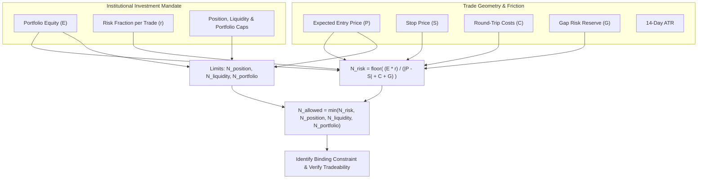

# Specification: Portfolio Construction & Risk Management (Step 7.1)

## 1. Overview & Mandate

Individual stock attractiveness (high composite scores or favorable qualitative catalysts) does not dictate portfolio sizing. Several individually attractive stocks may form an unbalanced or unviable portfolio if their sizing is unconstrained, if they share excessive sector correlation, or if they breach the firm's aggregate risk budget.

**Core Mandate**:
Position sizing must be derived strictly from **risk**, not score alone.

---

## 2. Mathematical Position Sizing Model

### 2.1 Definitions
- **$E$**: Current portfolio equity in base currency ($E > 0$).
- **$r$**: Permitted fraction of equity at risk for a trade ($0 < r \le 0.05$, default $1.0\% = 0.010$).
- **$P$**: Expected entry execution price ($P > 0$).
- **$S$**: Stop loss price ($S > 0$).
- **$C$**: Estimated round-trip trading friction per share (slippage and commissions on entry and exit legs).
- **$G$**: Explicit reserve for price gap risk, expressed in price units ($G \ge 0$).

### 2.2 Preliminary Risk-Based Share Sizing
For any long or short directional trade:
$$N_{\text{risk}} = \left\lfloor \frac{E \cdot r}{|P - S| + C + G} \right\rfloor$$

Where:
- **Round-Trip Cost per Share ($C$)**:
  $$C = P \times \frac{(\text{slippage\_bps} + \text{commission\_bps}) \times 2}{10\,000}$$
  *(e.g., 5 bps slippage + 1 bps commission per leg = 12 bps total round trip friction)*
- **Gap Risk Reserve per Share ($G$)**:
  $$G = \begin{cases}
  k_{\text{gap}} \times \text{ATR}_{14} & \text{if ATR is valid and } > 0 \\
  P \times g_{\text{default}} & \text{otherwise (fallback, default 1.0\% of } P)
  \end{cases}$$
  *(default $k_{\text{gap}} = 0.50$ ATR)*

> [!NOTE]
> This formulation is a starting risk model, not a guarantee of realized maximum loss. Stop orders execute at prevailing market prices when the market gaps down or up, and a gap-risk reserve cushions but cannot eliminate that possibility.

---

## 3. Limit Caps & Binding Constraint Resolution

To prevent over-concentration, excessive market impact, or portfolio leverage breaches, the final permissible share count imposes three independent caps:

$$N_{\text{allowed}} = \min(N_{\text{risk}}, N_{\text{position cap}}, N_{\text{liquidity cap}}, N_{\text{portfolio cap}})$$

### 3.1 The Three Hard Caps:
1. **Position Size Cap ($N_{\text{position cap}}$)**:
   Caps exposure to any single company to avoid single-stock catastrophe:
   $$N_{\text{position cap}} = \left\lfloor \frac{E \times \text{max\_position\_pct}}{P} \right\rfloor$$
   *(Default: maximum 10.0% of portfolio equity in any single stock)*

2. **Liquidity Participation Cap ($N_{\text{liquidity cap}}$)**:
   Protects against adverse market impact and slippage in illiquid names:
   $$N_{\text{liquidity cap}} = \left\lfloor \text{ADV}_{\text{shares}} \times \text{max\_adv\_pct} \right\rfloor = \left\lfloor \frac{\text{ADV}_{\text{dollars}} \times \text{max\_adv\_pct}}{P} \right\rfloor$$
   *(Default: maximum 1.0% of 20-day Average Daily Volume)*

3. **Remaining Portfolio Exposure Cap ($N_{\text{portfolio cap}}$)**:
   Prevents gross portfolio exposure from exceeding the mandate ceiling:
   $$\text{Available Capacity} = \max\left(0.0, E \times \text{max\_gross\_pct} - \text{current\_gross\_exposure}\right)$$
   $$N_{\text{portfolio cap}} = \left\lfloor \frac{\text{Available Capacity}}{P} \right\rfloor$$
   *(Default: maximum 100% unleveraged gross exposure)*

### 3.2 Binding Constraint Identification:
The system logs which constraint is actively binding on the trade:
- `ZERO_ALLOCATION`: $N_{\text{allowed}} = 0$ (portfolio full, non-positive parameters, or inverted stop).
- `RISK_BUDGET`: $N_{\text{allowed}} = N_{\text{risk}}$ (risk per share and risk fraction limit the trade).
- `POSITION_CAP`: $N_{\text{allowed}} = N_{\text{position cap}}$ (single-stock equity limit binds).
- `LIQUIDITY_CAP`: $N_{\text{allowed}} = N_{\text{liquidity cap}}$ (ADV volume participation limit binds).
- `PORTFOLIO_CAP`: $N_{\text{allowed}} = N_{\text{portfolio cap}}$ (gross portfolio headroom binds).

---

## 4. Inviolable Invariant: Sizing From Risk, Not Score Alone

> [!IMPORTANT]
> **Mandate Invariant**: A stock with a composite score of 90.0 does **NOT** receive a larger risk budget than a stock with a composite score of 70.0 (or 60.0). Both receive the identical fraction of equity at risk ($r = 1.0\%$) under the formal investment mandate.

Score determines **eligibility** (whether to enter, hold, or sell) via compliance gates; it does not arbitrarily inflate capital at risk. Score-based budget scaling is strictly disabled by default (`allow_score_budget_scaling = False`) and can only be activated if an empirically validated scaling schedule is explicitly configured.

---

## 5. Fail-Closed Boundaries & Safety Guarantees

The position sizing engine enforces strict fail-closed safety:
1. **Non-Positive Equity**: $E \le 0 \implies 0$ shares (`INVALID_INPUTS`).
2. **Non-Positive Price or Stop**: $P \le 0 \lor S \le 0 \implies 0$ shares (`INVALID_INPUTS`).
3. **Zero Risk Denominator**: $P = S \implies 0$ shares (zero stop distance rejected).
4. **Inverted Directional Geometry**:
   - Long trade with $S \ge P \implies 0$ shares.
   - Short trade with $S \le P \implies 0$ shares.
5. **Extreme Float Robustness**: NaNs, infinities, and overflow inputs immediately return 0 shares without throwing unhandled exceptions.

---

## 6. Implementation Architecture

### 6.1 Core Modules
- **[`quant/position_sizing.py`](file:///home/bhavin/Desktop/git/ai_trader_gemini/quant/position_sizing.py)** (and re-export [`position_sizing.py`](file:///home/bhavin/Desktop/git/ai_trader_gemini/position_sizing.py)):
  - `InvestmentMandate`: Formal institutional mandate dataclass with `from_policy()` factory.
  - `PositionSizingResult`: Full audit result tracking share counts, effective risk, binding constraint, and dollar exposures.
  - `calculate_risk_based_position_size()`: Primary deterministic sizing function.
- **[`quant/policy_config.py`](file:///home/bhavin/Desktop/git/ai_trader_gemini/quant/policy_config.py)** & **[`config/trading_policy.yaml`](file:///home/bhavin/Desktop/git/ai_trader_gemini/config/trading_policy.yaml)**:
  - Added `PortfolioRiskConfig` with institutional defaults and YAML parsing.
- **[`quant/structured_decision.py`](file:///home/bhavin/Desktop/git/ai_trader_gemini/quant/structured_decision.py)**:
  - Certified `BUY` and `SELL` decisions automatically calculate and embed `position_sizing` in `StructuredDecision.metrics`.
- **[`main.py`](file:///home/bhavin/Desktop/git/ai_trader_gemini/main.py)**:
  - Exposes `position_sizing` in the canonical dictionary output.

---

## 7. Test Suite Health & Verification Results

The automated test suite in [`tests/test_position_sizing.py`](file:///home/bhavin/Desktop/git/ai_trader_gemini/tests/test_position_sizing.py) covers:
1. Exact formula math for $N_{\text{risk}}$ under long and short setups.
2. Invariant verification that scores 90, 70, and 60 receive identical risk budgets.
3. Every individual constraint binding (`RISK_BUDGET`, `POSITION_CAP`, `LIQUIDITY_CAP`, `PORTFOLIO_CAP`, `ZERO_ALLOCATION`).
4. Slippage and commission friction per share ($C$).
5. Gap risk reserve ($G$) via ATR and price percentage fallback.
6. Fail-closed rejection on invalid, zero, negative, inverted, or NaN/Inf inputs.
7. Full pipeline integration with `StructuredDecisionEngine` and `TradingPolicy`.

| Test Suite | Result | Duration | Scope |
| :--- | :---: | :---: | :--- |
| **Step 7.1 Position Sizing** (`tests/test_position_sizing.py`) | **20 / 20 PASS** | 0.38s | Formula math, invariants, caps, safety |
| **All Quant Tests** (`tests/`) | **267 PASS, 1 SKIPPED** | 5.32s | Full quantitative regression suite |
| **Entire Repository Pytest** (`pytest`) | **522 PASS, 1 SKIPPED** | 8.19s | Complete codebase |
| **Unittest Discovery** (`unittest`) | **255 PASS, 0 FAIL** | 2.42s | Root runner |
