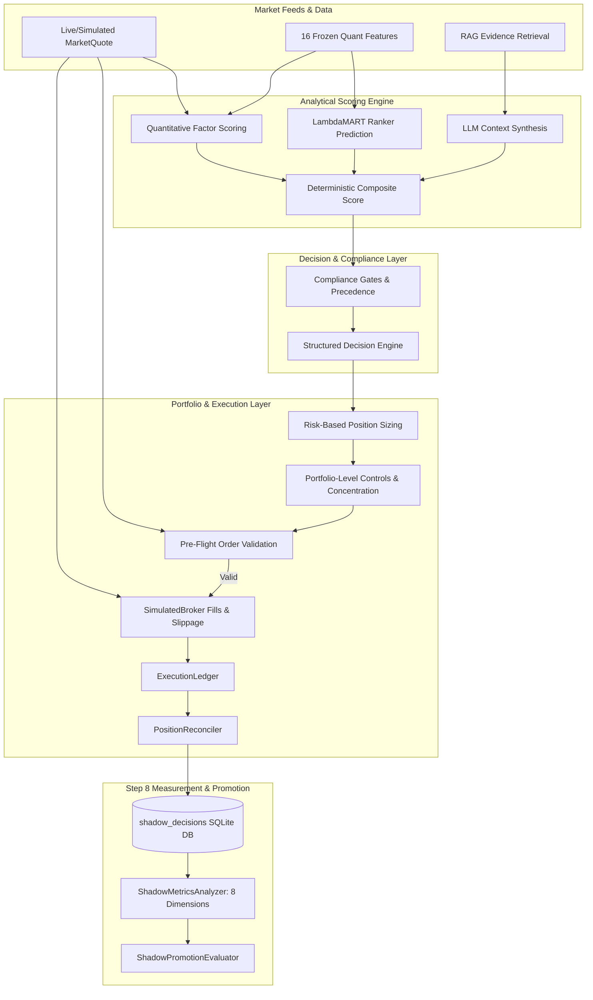

# Step 8 Specification: Shadow Trading & Institutional Promotion Verification

## 1. Executive Summary & Objective

**Step 8 (Shadow Trade the Complete Workflow)** establishes a non-broker operational verification environment that runs the complete analytical and execution pipeline in simulated production conditions.

The objective is to validate end-to-end strategy health, signal reproducibility, latency, predictive edge, execution friction, model drift, Point-in-Time temporal integrity, and risk compliance over a defined observation window *before* routing orders to an external broker.

A candidate strategy is only eligible for live production execution once it satisfies pre-defined institutional promotion criteria evaluated by the `ShadowPromotionEvaluator`.

---

## 2. Complete Workflow Without Broker Transmission



---

## 3. The Eight Formal Shadow Trading Measurements

| # | Measurement Dimension | Primary Metric & Formula | Institutional Target | Failure Consequence / Remediation |
|---|-----------------------|--------------------------|----------------------|-----------------------------------|
| **1** | **Signal Reproducibility** | Rate of exact decision, composite score, and reason code matches across identical snapshots: $\frac{N_{\text{identical}}}{N_{\text{eval}}}$ | $100.0\%$ ($\ge 99.0\%$) | Non-deterministic signals route to `STEP_5_COMPLIANCE_GATES_REMEDIATION`. |
| **2** | **Decision Latency & Data Freshness** | P95 decision latency and quote staleness violation rate: $\frac{N_{\text{stale}}}{N_{\text{total}}}$ where $\text{age} > t_{\text{max}}$ | P95 $\le 10.0$ s; Staleness $\le 1.0\%$ | Feed latency routes to `STEP_5_4_DATA_QUALITY_CONTRACT_REMEDIATION`. |
| **3** | **Predicted vs. Realized Returns** | Spearman Rank Information Coefficient ($\rho_{\text{IC}}$) and Directional Accuracy: $\rho_{\text{IC}} = \frac{\text{Cov}(R(\hat{y}), R(y))}{\sigma_{R(\hat{y})} \sigma_{R(y)}}$ | $\rho_{\text{IC}} \ge 0.00$; Dir Acc $\ge 50.0\%$ | Negative IC / low accuracy routes to `STEP_2_3_FACTOR_REMEDIATION` or `STEP_3_ML_TRAINING_REMEDIATION`. |
| **4** | **Cost-Adjusted Performance** | Net return, slippage drag in bps, Net Sharpe ratio, and profit factor: $\text{Drag}_{\text{bps}} = (R_{\text{gross}} - R_{\text{net}}) \times 100$ | Net Expectancy $> 0.0\%$; Profit Factor $\ge 1.0$ | Excessive friction routes to `STEP_7_3_EXECUTION_COST_REMEDIATION`. |
| **5** | **Gate Rejection Rate & Attribution** | Rejection rate % and filter efficiency delta: $\Delta_{\text{filter}} = \bar{R}_{\text{certified}} - \bar{R}_{\text{rejected}}$ | Certified trades outperform rejected ($\Delta_{\text{filter}} \ge -0.50\%$) | Inefficient filtering routes to `STEP_5_COMPLIANCE_GATES_REMEDIATION`. |
| **6** | **Model Feature Drift** | Population Stability Index (PSI) across core feature distributions: $\text{PSI} = \sum (P_A - P_E) \ln\left(\frac{P_A}{P_E}\right)$ | Overall $\text{PSI} < 0.25$ ($\text{PSI} < 0.10$ ideal) | Material drift routes to `STEP_3_WALK_FORWARD_RETRAINING`. |
| **7** | **LLM Quality & Temporal Integrity** | Point-in-Time availability audit; rate of look-ahead leakage: $T_{\text{published}} > T_{\text{signal}}$ | $0.0\%$ leakage tolerance | Temporal leakage routes to `STEP_4_RAG_POINT_IN_TIME_REMEDIATION`. |
| **8** | **Risk & Order State Compliance** | Concentration compliance, risk budget adherence, and ledger discrepancy rate | $0$ reconciliation errors; $0$ concentration breaches | Mismatch routes to `STEP_7_3_RECONCILIATION_REMEDIATION`. |

---

## 4. Predefined Institutional Promotion Criteria

A shadow trading session is evaluated by `ShadowPromotionEvaluator.evaluate()` against the following codified gates:

```yaml
shadow_trading:
  min_observations_for_promotion: 20      # Minimum trade observations required
  min_reproducibility_rate: 0.99        # Minimum 99% signal reproducibility
  max_freshness_violation_rate: 0.01    # Maximum 1% stale quote violation rate
  max_p95_latency_seconds: 10.0         # Maximum 10.0s P95 decision latency
  min_spearman_ic: 0.0                  # Non-negative Spearman rank IC
  min_directional_accuracy: 0.50        # Minimum 50% directional accuracy
  min_net_expectancy_pct: 0.0           # Positive net return after slippage/commissions
  min_profit_factor: 1.0                # Profit factor >= 1.0
  max_feature_psi: 0.25                 # Maximum PSI feature drift (< 0.25)
  max_temporal_leakage_rate: 0.0        # Zero tolerance for look-ahead leakage
  max_reconciliation_error_rate: 0.0    # Zero tolerance for ledger reconciliation mismatch
  max_drawdown_pct: 0.10                # Max 10% drawdown
```

### Verdict Taxonomy:
1. `PROMOTED_TO_PRODUCTION`: All 8 measurement dimensions satisfy institutional thresholds.
2. `INSUFFICIENT_OBSERVATIONS`: Total observations $N < 20$. Strategy remains in shadow trading until statistical significance is achieved.
3. `REJECTED_FOR_PROMOTION`: One or more gates failed, generating automated remediation routing and diagnostic instructions.

---

## 5. Architectural Separation of Concerns

To preserve modularity without adding bloat to `main.py`:
- `quant/shadow_trading.py`: Core simulation runner, mathematical rank IC, PSI drift calculations, measurement analyzer, and promotion evaluator.
- `shadow_trading.py`: Root level re-export module.
- `shadow_trader.py`: Standalone CLI orchestrator supporting universe sweeps, persistence, and audit report generation.
- `db.py`: SQLite persistence schema (`shadow_decisions` table) and transaction queries (`save_shadow_decision`, `update_shadow_decision_outcome`, `get_shadow_decisions`).
- `tests/test_shadow_trading.py`: 18 targeted unit and integration tests verifying all 8 measurement suites and remediation routing.

---

## 6. CLI Usage & Demonstration

Run a shadow trading session across the 25-stock ETF leader universe:
```bash
# Run full 25-stock ETF leader universe sweep with promotion evaluation
PYTHONPATH=. ./venv/bin/python shadow_trader.py --all-universe

# Run target tickers with SQLite persistence
PYTHONPATH=. ./venv/bin/python shadow_trader.py --tickers NVDA,AMD,AVGO,MSFT,AAPL --persist-db

# Generate JSON format audit report
PYTHONPATH=. ./venv/bin/python shadow_trader.py --all-universe --format json --output-file shadow_audit.json
```
